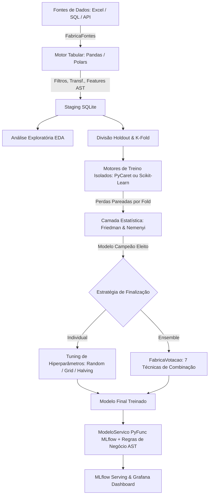

# Documentação Técnica e Arquitetural — Machine Learning Apartamentos Ribeirão Preto

## 1. Visão Geral e Arquitetura do Sistema

Este projeto implementa uma solução corporativa de alta performance para previsão de preços de apartamentos em Ribeirão Preto - SP. A arquitetura foi desenvolvida seguindo os princípios de engenharia de software **SOLID**, separação de conceitos através de **GoF Patterns** (Factory, Adapter, Strategy, Facade) e contratos estritos via `typing.Protocol`, com tipagem estática rigorosa em **Python 3.12+** sem o uso de `typing.Any` ou `object`.

### Diagrama Arquitetural de Fluxo de Dados



### Principais Decisões Arquiteturais
- **Sem FastAPI**: O modelo treinado é empacotado através do `ModeloServico` herdando de `mlflow.pyfunc.PythonModel`, permitindo deploy nativo e conteinerizado via `mlflow models serve`.
- **Isolamento Físico de Frameworks**: A trilha PyCaret utiliza exclusivamente suas funções nativas (`RegressionExperiment`, `create_model`, `tune_model`, `finalize_model`), enquanto a trilha Scikit-Learn opera de forma 100% desacoplada com `Pipeline`, `ColumnTransformer` e buscas nativas.
- **Segurança de Execução (AST)**: Nenhuma configuração em YAML executa comandos `eval` ou `exec` arbitrários. Expressões de filtros, transformações e regras de negócio passam por um interpretador de AST (Abstract Syntax Tree) restritivo com lista positiva de operadores e funções vetorizadas.

---

## 2. Camada Estatística Independente: Testes de Friedman e Nemenyi

Para evitar viés empírico e escolhas arbitrárias na seleção de modelos preditivos, o projeto adota o protocolo estatístico recomendado por Janez Demšar (*Statistical Comparisons of Classifiers over Multiple Data Sets*, JMLR 2006).

### 2.1. O Teste Não-Paramétrico de Friedman
O teste de Friedman é um teste estatístico não-paramétrico pareado (análogo à ANOVA de medidas repetidas), utilizado para comparar $k$ algoritmos de machine learning sobre $N$ blocos de validação (folds da validação cruzada pareada):

1. **Hipótese Nula ($H_0$)**: Todos os algoritmos apresentam desempenhos equivalentes e suas ordens de postos médios decorrem do acaso.
2. **Procedimento de Postos**: Em cada fold $i \in \{1, \dots, N\}$, os modelos são ranqueados pelo seu erro (RMSE). O melhor modelo recebe posto $r_i^j = 1$, o segundo melhor $r_i^j = 2$, e assim sucessivamente.
3. **Posto Médio**:
   $$R_j = \frac{1}{N} \sum_{i=1}^N r_i^j$$
4. **Estatística do Teste**:
   $$\chi_F^2 = \frac{12N}{k(k+1)} \left[ \sum_{j=1}^k R_j^2 - \frac{k(k+1)^2}{4} \right]$$
   Sob a hipótese nula, $\chi_F^2$ segue uma distribuição qui-quadrado com $k - 1$ graus de liberdade.

### 2.2. Pós-Teste de Nemenyi e Diferença Crítica (CD)
Quando o teste de Friedman rejeita a hipótese nula ao nível de significância $\alpha = 0.05$, aplica-se o pós-teste de Nemenyi para identificar quais pares de modelos diferem de forma estatisticamente significante.

Dois modelos são considerados estatisticamente diferentes se a distância entre seus postos médios for superior à **Diferença Crítica (Critical Difference - CD)**:
$$CD = q_\alpha \sqrt{\frac{k(k+1)}{6N}}$$
Onde $q_\alpha$ é o valor crítico da distribuição da amplitude studentizada normalizada.
O modelo que obtiver o **menor posto médio** (menor perda média) é eleito o **Modelo Campeão Estatístico**.

---

## 3. Estratégias de Votação e Combinação (Ensemble)

A `FabricaVotacao` oferece 7 técnicas desacopladas de combinação de regressores:
1. `media_simples`: Média aritmética simples das predições de todos os estimadores componentes.
2. `voting_regressor`: Utiliza a classe nativa `VotingRegressor` do Scikit-Learn.
3. `media_ponderada_rmse`: Pondera as predições pelo inverso do RMSE obtido em validação cruzada (modelos com menor erro têm maior peso).
4. `media_ponderada_postos`: Pondera as predições de acordo com a ordem de postos médios do teste de Friedman.
5. `mediana`: Mediana das predições por amostra (altamente robusta a estimadores que geram outliers discrepantes).
6. `media_aparada` (Trimmed Mean): Descarta a menor e a maior predição por amostra e calcula a média do intervalo central.
7. `stacking`: Meta-aprendizado com `StackingRegressor` do Scikit-Learn utilizando validação cruzada interna e meta-regressor (ex: `RidgeCV`).

---

## 4. Exemplos Completos de Expressões Python Seguras via AST

O sistema permite definir expressões declarativas no arquivo `configuracoes/projeto.yaml`. O interpretador restrito em `app/regras_negocio/avaliador_regras.py` avalia os nós da sintaxe abstrata (`ast.BinOp`, `ast.Compare`, `ast.Subscript`, `ast.Call`), proibindo acessos a arquivos, chamadas de sistema, imports e execução arbitrária.

### 4.1. Sintaxe de Filtros de Limpeza de Dados

Os filtros eliminam amostras inconsistentes antes da ingestão para o staging:

```yaml
filtros:
  ativo: true
  expressoes:
    # Sintaxe com df['coluna'] (Pandas) e pl.col('coluna') (Polars)
    - nome: metragem_positiva
      ativo: true
      expressao:
        pandas: "df['Metragem'] > 0"
        polars: "pl.col('Metragem') > 0"

    # Preço mínimo de apartamento realista em Ribeirão Preto
    - nome: preco_minimo_valido
      ativo: true
      expressao:
        pandas: "df['Valor_da_Venda'] >= 50000"
        polars: "pl.col('Valor_da_Venda') >= 50000"

    # Condomínio não negativo
    - nome: condominio_consistente
      ativo: true
      expressao:
        pandas: "df['Valor_do_Condominio'] >= 0"
        polars: "pl.col('Valor_do_Condominio') >= 0"

    # Descarte de outliers extremos de metragem
    - nome: filtro_outliers_metragem
      ativo: true
      expressao:
        pandas: "df['Metragem'] <= 600"
        polars: "pl.col('Metragem') <= 600"
```

### 4.2. Sintaxe de Transformações de Colunas Existentes

Transformações alteram colunas já existentes no DataFrame:

```yaml
transformacoes:
  ativo: true
  expressoes:
    # Limitação de teto inferior (clip)
    - nome: metragem_ajustada
      ativo: true
      destino: Metragem
      expressao:
        pandas: "df['Metragem'].clip(lower=15)"
        polars: "pl.col('Metragem').clip(lower_bound=15)"

    # Preenchimento de nulos em vagas de garagem
    - nome: vagas_imputadas
      ativo: true
      destino: Vagas_Garagem
      expressao:
        pandas: "df['Vagas_Garagem'].fillna(1)"
        polars: "pl.col('Vagas_Garagem').fill_null(1)"
```

### 4.3. Sintaxe de Criação de Novos Atributos (Feature Engineering)

Cria novas colunas calculadas a partir de variáveis brutas:

```yaml
atributos_novos:
  ativo: true
  expressoes:
    # Relação quartos por banheiro
    - nome: razao_quartos_banheiros
      ativo: true
      destino: Quartos_Por_Banheiro
      expressao:
        pandas: "df['Quartos'] / df['Banheiros']"
        polars: "pl.col('Quartos') / pl.col('Banheiros')"

    # Metragem quadrática (efeito não linear para árvores e regressão)
    - nome: metragem_quadrada
      ativo: true
      destino: Metragem_Quadrada
      expressao:
        pandas: "df['Metragem'] * df['Metragem']"
        polars: "pl.col('Metragem') * pl.col('Metragem')"

    # Estimativa de condomínio por m²
    - nome: condominio_por_m2
      ativo: true
      destino: Condominio_Por_M2
      expressao:
        pandas: "df['Valor_do_Condominio'] / df['Metragem']"
        polars: "pl.col('Valor_do_Condominio') / pl.col('Metragem')"
```

### 4.4. Sintaxe de Regras de Negócio de Pós-Processamento

As regras de negócio são aplicadas após a inferência do modelo campeão pelo `ModeloServico`, recebendo o vetor `preco_predito`:

```yaml
regras_negocio:
  ativo: true
  coluna_alvo_predito: preco_predito
  regras:
    # Faixa inferior para balizamento de negociação e proposta
    - nome: margem_inferior_negociacao
      ativo: true
      descricao: "5% abaixo da previsão do modelo"
      destino: preco_minimo_sugerido
      expressao: "preco_predito * 0.95"

    # Faixa superior de listagem no portal imobiliário
    - nome: margem_superior_negociacao
      ativo: true
      descricao: "5% acima da previsão do modelo"
      destino: preco_maximo_sugerido
      expressao: "preco_predito * 1.05"

    # Preço do m² baseado na predição do imóvel
    - nome: valor_metro_quadrado_predito
      ativo: true
      descricao: "Preço estimado por m²"
      destino: preco_m2_predito
      expressao: "preco_predito / Metragem"

    # Comissão padrão CRECI de corretagem (6%)
    - nome: taxa_comissao_imobiliaria
      ativo: true
      descricao: "Comissão estimada de corretagem"
      destino: valor_comissao_estimada
      expressao: "preco_predito * 0.06"
```

---

## 5. Suíte de Testes Automatizados e Quality Gates

O projeto possui qualidade de código garantida por 48 testes automatizados em Pytest, divididos em testes unitários e de integração:

| Arquivo de Teste | Quantidade | Escopo Validado |
|---|---|---|
| `tests/test_motor_sklearn.py` | 3 | Protocolo, 10 regressores configuráveis, Tuning por `grid` e `random`. |
| `tests/test_motor_pycaret.py` | 3 | Protocolo, `RegressionExperiment`, folds customizáveis, setup nativo. |
| `tests/test_modelos_votacao.py` | 7 | As 7 técnicas de ensemble (`VotingRegressor`, `Stacking`, `Mediana`, etc.). |
| `tests/test_teste_friedman.py` | 2 | Teste de Friedman, postos médios e pós-teste de Nemenyi com CD. |
| `tests/test_regras_negocio.py` | 4 | Segurança AST, bloqueio de injeção de código, vetorização Pandas. |
| `tests/test_motor_pandas.py` | 13 | Filtros, transformações, novas features e sintaxes vetorizadas `df[...]`. |
| `tests/test_motor_polars.py` | 7 | Filtros e expressões lazy/eager no motor Polars (`pl.col`). |
| `tests/test_repositorio_fonte.py` | 5 | Ingestão `FonteExcel`, `FonteSql`, `FonteApi` e Staging `RepositorioSqlite`. |
| `tests/test_main_pipeline.py` | 4 | Execuções completas end-to-end com PyCaret, Sklearn, Polars e Ensembles. |

### Como Executar os Testes

```bash
# Execução dos testes rápidos
.venv/bin/pytest tests/ -v -m "not pycaret"

# Execução completa da suíte
.venv/bin/pytest tests/ -v
```

---

## 6. Observabilidade e Dashboards no Grafana

O monitoramento do sistema é provisionado automaticamente em `config_ob/dashboards/dashboard_monitoramento_ml.json`:
1. **Saúde do Serviço**: Uptime, Throughput e Latência de inferência p50/p95/p99 via Prometheus.
2. **Resultados Estatísticos de ML**: Postos de Friedman e RMSE por modelo gravados nos metadados do MLflow.
3. **Métricas de EDA**: Mediana de preços de Ribeirão Preto, total de apartamentos no staging e taxa de nulos.
4. **Drift & Governança**: Índices PSI e KS para detecção de deriva do alvo predito e distribuição de acionamento das regras de negócio.
5. **Logs de Inferência**: Auditoria em tempo real via Grafana Loki.

---

## 7. Inicializador e Deploy: Script `executar_treinamento.sh`

Para agilizar o ciclo de vida do modelo em produção e em pipelines de CI/CD, o projeto inclui o script unificado `executar_treinamento.sh`.

### 7.1. Modos de Execução

- **Modo Rápido (`--apenas-campeao`)**:
  - Pula a bateria de validação cruzada pareada de todos os 10 modelos e o tuning de hiperparâmetros.
  - Consulta dinamicamente o último modelo campeão salvo no **MLflow Registry** (`previsao_preco_imoveis`).
  - Treina diretamente o campeão na base completa de staging e empacota no `ModeloServico(mlflow.pyfunc)` com as regras de negócio em AST.
  - Tempo de execução: **~14 segundos** (redução de 90% no tempo).
- **Modo Completo (`--modo completo`)**:
  - Executa a bateria científica completa: Ingestão, Staging, EDA, CV Pareada (10 modelos), Friedman/Nemenyi, Tuning e Registro MLflow.
  - Tempo de execução: **~130 segundos**.

### 7.2. Exemplos de Comandos

```bash
# Treinar o modelo campeão direto e subir/recarregar a API do MLflow Serving:
./executar_treinamento.sh --apenas-campeao --subir-api

# Apenas retreinar o campeão com novas regras de negócio e registrar no MLflow:
./executar_treinamento.sh --apenas-campeao

# Forçar um modelo específico (ex: LightGBM) e subir a API na porta 8080:
./executar_treinamento.sh --apenas-campeao --modelo lightgbm --subir-api --porta 8080

# Execução do benchmark exaustivo completo:
./executar_treinamento.sh --modo completo

# Ajuda e catálogo de opções:
./executar_treinamento.sh --ajuda
```

### 7.3. Consumo REST no Endpoint `/invocations`

```bash
curl -X POST http://localhost:8080/invocations \
     -H "Content-Type: application/json" \
     -d '{
       "dataframe_records": [
         {"Metragem": 110.0, "Quartos": 3, "Vagas": 2, "Banheiros": 2, "Condominio": 750.0}
       ]
     }'
```
Retorno JSON automático com predição e regras de negócio:
```json
[
  {
    "Metragem": 110.0,
    "Quartos": 3,
    "Vagas": 2,
    "Banheiros": 2,
    "Condominio": 750.0,
    "preco_predito": 540000.0,
    "preco_minimo_sugerido": 513000.0,
    "preco_maximo_sugerido": 567000.0,
    "preco_m2_predito": 4909.09,
    "valor_comissao_estimada": 32400.0
  }
]
```

### 7.4. Padrão GoF Observer no Ciclo de Vida do MLflow

O Subject `PublicadorServico` gerencia o ciclo de publicação e notifica observadores síncronos desacoplados através do protocolo `ObservadorMLflow`:
- **`ObservadorAuditoria`**: Persiste registros de governança e auditoria em `storage-data/auditoria_mlflow.jsonl` (ISO timestamp, run_id, model_uri, tags).
- **`ObservadorMetricas`**: Atualiza métricas Prometheus em `storage-data/metricas_mlflow.prom` (`mlflow_publicacao_sucesso_total`, `mlflow_publicacao_falha_total`, etc.).
- **Tratamento de Falhas**: Notifica eventos do tipo `falha_publicacao` permitindo observabilidade imediata em caso de indisponibilidade de tracking server.


