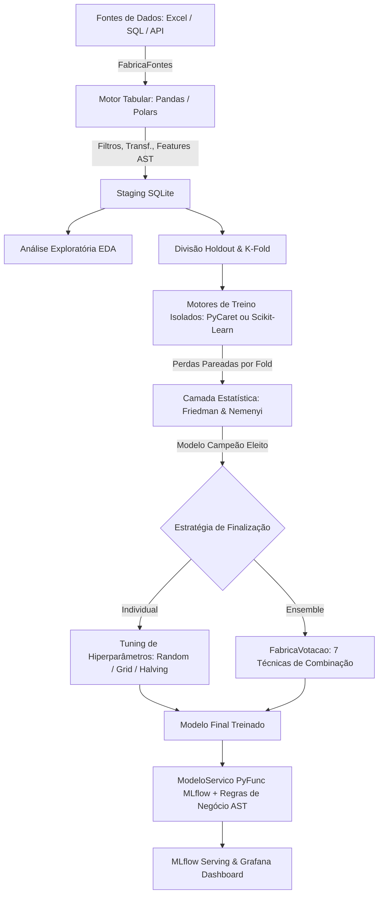

# Documentação Técnica e Arquitetural — Machine Learning Apartamentos Ribeirão Preto

## 1. Visão Geral e Arquitetura do Sistema

Este projeto implementa uma solução corporativa de alta performance para previsão de preços de apartamentos em Ribeirão Preto - SP. A arquitetura foi desenvolvida seguindo os princípios de engenharia de software **SOLID**, separação de conceitos através de **GoF Patterns** (Factory, Adapter, Strategy, Facade) e contratos estritos via `typing.Protocol`, com tipagem estática rigorosa em **Python 3.12+** sem o uso de `typing.Any` ou `object`.

### Diagrama Arquitetural de Fluxo de Dados



### Principais Decisões Arquiteturais
- **Sem FastAPI**: O modelo treinado é empacotado através do `ModeloServico` herdando de `mlflow.pyfunc.PythonModel`, permitindo deploy nativo e conteinerizado via `mlflow models serve`.
- **Isolamento Físico de Frameworks**: A trilha PyCaret utiliza exclusivamente suas funções nativas (`RegressionExperiment`, `create_model`, `tune_model`, `finalize_model`), enquanto a trilha Scikit-Learn opera de forma 100% desacoplada com `Pipeline`, `ColumnTransformer` e buscas nativas.
- **Segurança de Execução (AST)**: Nenhuma configuração em YAML executa comandos `eval` ou `exec` arbitrários. Expressões de filtros, transformações e regras de negócio passam por um interpretador de AST (Abstract Syntax Tree) restritivo com lista positiva de operadores e funções vetorizadas.

---

## 2. Catálogo Completo dos Padrões de Projeto GoF (Gang of Four)

Para afastar o anti-padrão de scripts monolíticos e códigos experimentais desestruturados em Machine Learning, a engenharia do projeto foi desenhada a partir de padrões consagrados do **Gang of Four (GoF)**. O sistema utiliza composição sobre herança, polimorfismo estrutural através de contratos estritos (`typing.Protocol`), inversão de dependência e desacoplamento físico total entre bibliotecas.

### 2.1. Matriz de Padrões GoF Implementados

| Padrão GoF | Família | Componentes / Classes | Arquivo no Repositório | Contrato / Protocolo | Papel Arquitetural e Regra Atendida |
| :--- | :--- | :--- | :--- | :--- | :--- |
| **Factory Method / Factory** | **Criacional** | [`FabricaFontes`](file:///home/rodrigo/PycharmProjects/machine_learning_apartamentos_rp_pycarret/app/fontes_dados/fabrica_fontes.py)<br>[`FabricaMotores`](file:///home/rodrigo/PycharmProjects/machine_learning_apartamentos_rp_pycarret/app/motores_tabela/fabrica_motores.py)<br>[`FabricaVotacao`](file:///home/rodrigo/PycharmProjects/machine_learning_apartamentos_rp_pycarret/app/modelos_votacao/fabrica_votacao.py) | `app/fontes_dados/`<br>`app/motores_tabela/`<br>`app/modelos_votacao/` | `FonteDados`<br>`MotorTabela`<br>`ModeloPreditor` | Instanciação dinâmica baseada 100% no arquivo `projeto.yaml`, sem expor construtores concretos ao cliente. |
| **Adapter (Wrapper)** | **Estrutural** | [`MotorSklearn`](file:///home/rodrigo/PycharmProjects/machine_learning_apartamentos_rp_pycarret/app/motores_treino/motor_sklearn.py)<br>[`MotorPycaret`](file:///home/rodrigo/PycharmProjects/machine_learning_apartamentos_rp_pycarret/app/motores_treino/motor_pycaret.py)<br>[`FonteExcel`](file:///home/rodrigo/PycharmProjects/machine_learning_apartamentos_rp_pycarret/app/fontes_dados/fonte_excel.py)<br>[`ModeloServico`](file:///home/rodrigo/PycharmProjects/machine_learning_apartamentos_rp_pycarret/app/orquestracao_ml/modelo_servico.py) | `app/motores_treino/`<br>`app/fontes_dados/`<br>`app/orquestracao_ml/` | `MotorTreino`<br>`FonteDados`<br>`mlflow.pyfunc.PythonModel` | Unifica APIs externas divergentes (Scikit-Learn x PyCaret; pandas/openpyxl; MLflow Serving) sob interfaces padronizadas de domínio. |
| **Composite** | **Estrutural** | [`RegressorVotacao`](file:///home/rodrigo/PycharmProjects/machine_learning_apartamentos_rp_pycarret/app/modelos_votacao/regressor_votacao.py) | `app/modelos_votacao/` | `ModeloPreditor` | Trata comitês heterogêneos de regressores (Random Forest, XGBoost, etc.) como se fossem um único objeto `ModeloPreditor`. |
| **Facade** | **Estrutural** | [`MainPipeline`](file:///home/rodrigo/PycharmProjects/machine_learning_apartamentos_rp_pycarret/app/orquestracao_ml/main_pipeline.py) | `app/orquestracao_ml/` | Pipeline de Execução | Ponto único de alto nível que simplifica e orquestra a complexidade de 10 subsistemas integrados (ingestão, staging, EDA, CV pareada, Friedman, regras e deploy). |
| **Strategy** | **Comportamental** | [`MotorPandas`](file:///home/rodrigo/PycharmProjects/machine_learning_apartamentos_rp_pycarret/app/motores_tabela/motor_pandas.py) vs [`MotorPolars`](file:///home/rodrigo/PycharmProjects/machine_learning_apartamentos_rp_pycarret/app/motores_tabela/motor_polars.py)<br>Motores de Treino<br>Particionadores de CV (5 tipos)<br>Técnicas de Votação (7 tipos) | `app/motores_tabela/`<br>`app/motores_treino/`<br>`app/modelos_votacao/` | `MotorTabela`<br>`MotorTreino`<br>Contratos Matemáticos | Famílias de algoritmos intercambiáveis em tempo de execução via configuração (vetorização, split de validação cruzada e comitês de ensemble). |
| **Observer** | **Comportamental** | [`PublicadorServico`](file:///home/rodrigo/PycharmProjects/machine_learning_apartamentos_rp_pycarret/app/orquestracao_ml/publicador_servico.py) (Subject)<br>[`ObservadorAuditoria`](file:///home/rodrigo/PycharmProjects/machine_learning_apartamentos_rp_pycarret/app/orquestracao_ml/observador_auditoria.py)<br>[`ObservadorMetricas`](file:///home/rodrigo/PycharmProjects/machine_learning_apartamentos_rp_pycarret/app/orquestracao_ml/observador_metricas.py) | `app/orquestracao_ml/` | [`ObservadorMLflow`](file:///home/rodrigo/PycharmProjects/machine_learning_apartamentos_rp_pycarret/app/contratos_dados/observador_mlflow.py) | Emissão reativa e desacoplada de eventos de publicação e deploy no MLflow para auditoria imutável (JSONL) e métricas (Prometheus). |
| **Interpreter** | **Comportamental** | [`AvaliadorRegras`](file:///home/rodrigo/PycharmProjects/machine_learning_apartamentos_rp_pycarret/app/regras_negocio/avaliador_regras.py) | `app/regras_negocio/` | AST Visitor Seguro | Avalia expressões matemáticas de filtros e regras de negócio diretamente na árvore sintática abstrata (AST), sem invocar `eval()` ou `exec()`. |
| **Repository** | **Persistência** | [`RepositorioSqlite`](file:///home/rodrigo/PycharmProjects/machine_learning_apartamentos_rp_pycarret/app/repositorios_dados/repositorio_sqlite.py) | `app/repositorios_dados/` | `RepositorioDados` | Isola as operações de persistência intermediária em banco de dados relacional (SQLite staging) das regras analíticas. |

---

### 2.2. Detalhamento dos Padrões por Família

#### 1. Padrões Criacionais (Creational)
- **`FabricaFontes`**: Abstrai a criação de fontes heterogêneas (`FonteExcel`, `FonteSql`, `FonteApi`). Permite migrar a ingestão de uma planilha de apartamentos para uma API imobiliária REST alterando apenas a chave `tipo_fonte` do `projeto.yaml`.
- **`FabricaMotores`**: Instancia dinamicamente o motor de processamento tabular (`MotorPandas` ou `MotorPolars`), garantindo que o resto da aplicação interaja exclusivamente com a interface semântica `MotorTabela`.
- **`FabricaVotacao`**: Constrói instâncias dos 7 comitês de votação (Média Simples, Ponderada por R², Mediana, Rank Average, Trimmed Mean, Stacking Linear ou Voting Nativo).

#### 2. Padrões Estruturais (Structural)
- **`Adapter (Wrapper)` nos Motores de Treino**:
  - O PyCaret baseia-se em uma máquina de estados procedural (`RegressionExperiment`, `setup`, `create_model`, `pull`).
  - O Scikit-Learn opera com transformadores colunares, pipelines orientados a objetos e estimadores encapsulados.
  - Os adaptadores `MotorSklearn` e `MotorPycaret` implementam o contrato `MotorTreino`, permitindo alternar de framework no arquivo YAML sem alterar o orquestrador do pipeline.
- **`Adapter` no `ModeloServico` para MLflow**:
  - Adapta o estimador final treinado e o avaliador de regras de negócio AST para a classe padrão `mlflow.pyfunc.PythonModel`. A inferência no endpoint `/invocations` executa o modelo estatístico e em seguida calcula dinamicamente todas as colunas de pós-processamento configuradas no YAML.
- **`Composite` no `RegressorVotacao`**:
  - Agrupa uma coleção heterogênea de objetos `ModeloPreditor` (ex: Random Forest, XGBoost e LightGBM). Ao chamar `predizer(dados)`, o composite distribui as inferências aos componentes e agrega os resultados conforme a estratégia selecionada.
- **`Facade` no `MainPipeline`**:
  - Fachada unificada que oculta a interação com 10 subsistemas de dados, modelagem e infraestrutura (Ingestão -> Staging -> EDA -> Split -> Motores -> Friedman/Nemenyi -> Ensemble -> Diagnóstico -> Regras -> MLflow).

#### 3. Padrões Comportamentais (Behavioral)
- **`Strategy`**:
  - Motores Tabulares: Estratégias vetorizadas intercambiáveis (`MotorPandas` vs `MotorPolars`).
  - Validação Cruzada: Estratégias de particionamento amostral (`KFold`, `RepeatedKFold`, `StratifiedKFold`, `GroupKFold`, `TimeSeriesSplit`).
  - Combinação Preditiva: 7 estratégias matemáticas de consenso para cálculo do valor do imóvel.
- **`Observer`**:
  - O `PublicadorServico` (Subject) notifica observadores que implementam `ObservadorMLflow` após cada operação de publicação.
  - `ObservadorAuditoria`: Persiste um registro imutável em JSONL (`auditoria_publicacoes.jsonl`) com timestamp, run_id, autor, status e métricas.
  - `ObservadorMetricas`: Atualiza contadores e histogramas para observabilidade e telemetria (compatível com Prometheus e Grafana).
- **`Interpreter`**:
  - O `AvaliadorRegras` implementa um interpretador recursivo de nós AST autorizados (`ast.BinOp`, `ast.UnaryOp`, `ast.Compare`, etc.). Garante conformidade estrita com a regra de segurança do projeto, impedindo injeção de código arbitrário.
- **`Repository`**:
  - O `RepositorioSqlite` desacopla a persistência em banco relacional SQLite intermediário da lógica analítica e de machine learning.

---

## 3. Camada Estatística Independente: Testes de Friedman e Nemenyi

Para evitar viés empírico e escolhas arbitrárias na seleção de modelos preditivos, o projeto adota o protocolo estatístico recomendado por Janez Demšar (*Statistical Comparisons of Classifiers over Multiple Data Sets*, JMLR 2006).

### 3.1. O Teste Não-Paramétrico de Friedman
O teste de Friedman é um teste estatístico não-paramétrico pareado (análogo à ANOVA de medidas repetidas), utilizado para comparar $k$ algoritmos de machine learning sobre $N$ blocos de validação (folds da validação cruzada pareada):

1. **Hipótese Nula ($H_0$)**: Todos os algoritmos apresentam desempenhos equivalentes e suas ordens de postos médios decorrem do acaso.
2. **Procedimento de Postos**: Em cada fold $i \in \{1, \dots, N\}$, os modelos são ranqueados pelo seu erro (RMSE). O melhor modelo recebe posto $r_i^j = 1$, o segundo melhor $r_i^j = 2$, e assim sucessivamente.
3. **Posto Médio**:
   $$R_j = \frac{1}{N} \sum_{i=1}^N r_i^j$$
4. **Estatística do Teste**:
   $$\chi_F^2 = \frac{12N}{k(k+1)} \left[ \sum_{j=1}^k R_j^2 - \frac{k(k+1)^2}{4} \right]$$
   Sob a hipótese nula, $\chi_F^2$ segue uma distribuição qui-quadrado com $k - 1$ graus de liberdade.

### 3.2. Pós-Teste de Nemenyi e Diferença Crítica (CD)
Quando o teste de Friedman rejeita a hipótese nula ao nível de significância $\alpha = 0.05$, aplica-se o pós-teste de Nemenyi para identificar quais pares de modelos diferem de forma estatisticamente significante.

Dois modelos são considerados estatisticamente diferentes se a distância entre seus postos médios for superior à **Diferença Crítica (Critical Difference - CD)**:
$$CD = q_\alpha \sqrt{\frac{k(k+1)}{6N}}$$
Onde $q_\alpha$ é o valor crítico da distribuição da amplitude studentizada normalizada.
O modelo que obtiver o **menor posto médio** (menor perda média) é eleito o **Modelo Campeão Estatístico**.

---

## 3. Pré-Processamento Avançado: Transformação do Alvo e dos Atributos Preditores

O sistema suporta transformação matemática configurável de forma 100% declarativa no [configuracoes/projeto.yaml](file:///home/rodrigo/PycharmProjects/machine_learning_apartamentos_rp_pycarret/configuracoes/projeto.yaml), tanto para o alvo monetário ($y$) quanto para as variáveis explicativas contínuas ($X$):

```yaml
preprocessamento:
  transformar_alvo: true              # Treina em escala transformada com reversão automática
  metodo_transformacao_alvo: log1p   # log1p (padrão) | log | yeo-johnson | box-cox
  transformar_atributos:
    ativo: true                       # Aplica transformação logarítmica nas features selecionadas
    metodo: log1p                    # log1p | log | yeo-johnson
    colunas: [Metragem, Area_Privativa, Valor_Condominio, Valor_Iptu]
```

### 3.1. Transformação do Alvo com Reversão Automática
- **Objetivo**: Estabilizar a variância dos resíduos (homocedasticidade) e mitigar o viés gerado por imóveis de alto padrão (cauda longa).
- **Trilha Scikit-Learn**: Encapsulamento com `TransformedTargetRegressor(func=np.log1p, inverse_func=np.expm1)`, garantindo que todas as predições e métricas de validação cruzada voltem automaticamente para a escala original em reais ($R\$$).
- **Trilha PyCaret**: Invocação nativa de `transform_target=True` e `transform_target_method="yeo-johnson"`.

### 3.2. Transformação Logarítmica dos Atributos Preditores (Features)
- **Linearização e Retornos Decrescentes**: Atributos contínuos como `Metragem` possuem retornos marginais decrescentes. Ao aplicar $\log(1 + x)$ nas features contínuas selecionadas, a relação multiplicativa de área e preço converte-se em linear aditiva.
- **Interpretação Econômica (Modelo Log-Log)**: Quando tanto o alvo quanto a metragem estão em log, os coeficientes dos modelos lineares representam a **elasticidade direta**: cada acréscimo de 1% na metragem corresponde a uma variação de $\beta\%$ no preço.
- **Implementação no Scikit-Learn**: Inclusão de `FunctionTransformer(np.log1p)` no `ColumnTransformer` especificamente nas colunas numéricas configuradas, preservando contagens discretas (`Quartos`, `Suites`, `Vagas`) sem distorção.
- **Implementação no PyCaret**: Configuração nativa via `transformation=True` e `transformation_method="yeo-johnson"`.

---

## 4. Estratégias de Votação e Combinação (Ensemble)

A `FabricaVotacao` oferece 7 técnicas desacopladas de combinação de regressores:
1. `media_simples`: Média aritmética simples das predições de todos os estimadores componentes.
2. `voting_regressor`: Utiliza a classe nativa `VotingRegressor` do Scikit-Learn.
3. `media_ponderada_rmse`: Pondera as predições pelo inverso do RMSE obtido em validação cruzada (modelos com menor erro têm maior peso).
4. `media_ponderada_postos`: Pondera as predições de acordo com a ordem de postos médios do teste de Friedman.
5. `mediana`: Mediana das predições por amostra (altamente robusta a estimadores que geram outliers discrepantes).
6. `media_aparada` (Trimmed Mean): Descarta a menor e a maior predição por amostra e calcula a média do intervalo central.
7. `stacking`: Meta-aprendizado com `StackingRegressor` do Scikit-Learn utilizando validação cruzada interna e meta-regressor (ex: `RidgeCV`).

---

## 5. Exemplos Completos de Expressões Python Seguras via AST

O sistema permite definir expressões declarativas no arquivo `configuracoes/projeto.yaml`. O interpretador restrito em `app/regras_negocio/avaliador_regras.py` avalia os nós da sintaxe abstrata (`ast.BinOp`, `ast.Compare`, `ast.Subscript`, `ast.Call`), proibindo acessos a arquivos, chamadas de sistema, imports e execução arbitrária.

### 5.1. Sintaxe de Filtros de Limpeza de Dados

Os filtros eliminam amostras inconsistentes antes da ingestão para o staging:

```yaml
filtros:
  ativo: true
  expressoes:
    # Sintaxe com df['coluna'] (Pandas) e pl.col('coluna') (Polars)
    - nome: metragem_positiva
      ativo: true
      expressao:
        pandas: "df['Metragem'] > 0"
        polars: "pl.col('Metragem') > 0"

    # Preço mínimo de apartamento realista em Ribeirão Preto
    - nome: preco_minimo_valido
      ativo: true
      expressao:
        pandas: "df['Valor_da_Venda'] >= 50000"
        polars: "pl.col('Valor_da_Venda') >= 50000"

    # Condomínio não negativo
    - nome: condominio_consistente
      ativo: true
      expressao:
        pandas: "df['Valor_do_Condominio'] >= 0"
        polars: "pl.col('Valor_do_Condominio') >= 0"

    # Descarte de outliers extremos de metragem
    - nome: filtro_outliers_metragem
      ativo: true
      expressao:
        pandas: "df['Metragem'] <= 600"
        polars: "pl.col('Metragem') <= 600"
```

### 5.2. Sintaxe de Transformações de Colunas Existentes

Transformações alteram colunas já existentes no DataFrame:

```yaml
transformacoes:
  ativo: true
  expressoes:
    # Limitação de teto inferior (clip)
    - nome: metragem_ajustada
      ativo: true
      destino: Metragem
      expressao:
        pandas: "df['Metragem'].clip(lower=15)"
        polars: "pl.col('Metragem').clip(lower_bound=15)"

    # Preenchimento de nulos em vagas de garagem
    - nome: vagas_imputadas
      ativo: true
      destino: Vagas_Garagem
      expressao:
        pandas: "df['Vagas_Garagem'].fillna(1)"
        polars: "pl.col('Vagas_Garagem').fill_null(1)"
```

### 5.3. Sintaxe de Criação de Novos Atributos (Feature Engineering)

Cria novas colunas calculadas a partir de variáveis brutas:

```yaml
atributos_novos:
  ativo: true
  expressoes:
    # Relação quartos por banheiro
    - nome: razao_quartos_banheiros
      ativo: true
      destino: Quartos_Por_Banheiro
      expressao:
        pandas: "df['Quartos'] / df['Banheiros']"
        polars: "pl.col('Quartos') / pl.col('Banheiros')"

    # Metragem quadrática (efeito não linear para árvores e regressão)
    - nome: metragem_quadrada
      ativo: true
      destino: Metragem_Quadrada
      expressao:
        pandas: "df['Metragem'] * df['Metragem']"
        polars: "pl.col('Metragem') * pl.col('Metragem')"

    # Estimativa de condomínio por m²
    - nome: condominio_por_m2
      ativo: true
      destino: Condominio_Por_M2
      expressao:
        pandas: "df['Valor_do_Condominio'] / df['Metragem']"
        polars: "pl.col('Valor_do_Condominio') / pl.col('Metragem')"
```

### 5.4. Sintaxe de Regras de Negócio de Pós-Processamento

As regras de negócio são aplicadas após a inferência do modelo campeão pelo `ModeloServico`, recebendo o vetor `preco_predito`:

```yaml
regras_negocio:
  ativo: true
  coluna_alvo_predito: preco_predito
  regras:
    # Faixa inferior para balizamento de negociação e proposta
    - nome: margem_inferior_negociacao
      ativo: true
      descricao: "5% abaixo da previsão do modelo"
      destino: preco_minimo_sugerido
      expressao: "preco_predito * 0.95"

    # Faixa superior de listagem no portal imobiliário
    - nome: margem_superior_negociacao
      ativo: true
      descricao: "5% acima da previsão do modelo"
      destino: preco_maximo_sugerido
      expressao: "preco_predito * 1.05"

    # Preço do m² baseado na predição do imóvel
    - nome: valor_metro_quadrado_predito
      ativo: true
      descricao: "Preço estimado por m²"
      destino: preco_m2_predito
      expressao: "preco_predito / Metragem"

    # Comissão padrão CRECI de corretagem (6%)
    - nome: taxa_comissao_imobiliaria
      ativo: true
      descricao: "Comissão estimada de corretagem"
      destino: valor_comissao_estimada
      expressao: "preco_predito * 0.06"
```

---

## 6. Suíte de Testes Automatizados e Quality Gates (81 Testes)

O projeto possui qualidade e conformidade rigorosamente comprovadas por **81 testes automatizados com pytest** (100% Passed):

| Arquivo de Teste | Quantidade | Escopo Validado | Status |
| :--- | :---: | :--- | :---: |
| `tests/test_comparador_transformacao.py` | 5 | Avaliação pareada Sem Log vs Com Log, dados sintéticos log-normais, Prometheus e validação estrutural do Grafana JSON. | **100% Passed** |
| `tests/test_diagnostico_curva.py` | 8 | Curvas viés x variância, hiperparâmetro dinâmico do modelo campeão (ex: rede neural, ridge, floresta), K-Fold e YAML. | **100% Passed** |
| `tests/test_importancia_atributos.py` | 4 | Extração de feature_importances_, \|coef_\|, permutação e painéis nativos Grafana. | **100% Passed** |
| `tests/test_motor_sklearn.py` | 5 | Protocolo, 10 regressores configuráveis, Tuning (grid, random, halving), transformação do alvo e transformação log de features contínuas. | **100% Passed** |
| `tests/test_motor_pycaret.py` | 5 | Integração nativa com PyCaret `RegressionExperiment`, fold strategies, setup, transformação do alvo e transformação de features. | **100% Passed** |
| `tests/test_modelos_votacao.py` | 8 | As 7 técnicas de ensemble (`VotingRegressor`, `Stacking`, `Mediana`, postos, aparada, etc.). | **100% Passed** |
| `tests/test_teste_friedman.py` | 2 | Teste não-paramétrico de Friedman, qui-quadrado, postos pareados e Nemenyi com CD. | **100% Passed** |
| `tests/test_regras_negocio.py` | 4 | Segurança AST, bloqueio de injeção de código, execução vetorizada de pós-processamento. | **100% Passed** |
| `tests/test_motor_pandas.py` | 7 | Vetorização Pandas, filtros com sintaxe `df['coluna']`, transformações e novas features. | **100% Passed** |
| `tests/test_motor_polars.py` | 8 | Execução Lazy/Eager no Polars, expressões `pl.col(...)` e compatibilidade tabular. | **100% Passed** |
| `tests/test_fonte_dados.py` | 6 | Ingestão polimórfica (Excel, SQL, API), fábrica de fontes de dados e leitura configurada via YAML. | **100% Passed** |
| `tests/test_repositorio_fonte.py` | 2 | Staging persistente SQLite e recuperação isolada para auditoria. | **100% Passed** |
| `tests/test_main_pipeline.py` | 5 | Execuções completas end-to-end com Sklearn, PyCaret, Polars, Ensembles e Modo Campeão. | **100% Passed** |
| `tests/test_publicador_mlflow.py` | 4 | Publicação de `ModeloServico` no MLflow, busca dinâmica do campeão e fallback seguro. | **100% Passed** |
| `tests/test_observador_mlflow.py` | 4 | Padrão GoF Observer no MLflow: auditoria JSONL e métricas Prometheus. | **100% Passed** |
| `tests/test_analise_eda.py` | 1 | Geração de gráficos EDA estatísticos e perfil de dados tabular. | **100% Passed** |
| `tests/test_modelo_servico.py` | 1 | Predição em tempo real com pós-processamento de regras de negócio em AST. | **100% Passed** |
| `tests/test_leitor_configuracao.py` | 1 | Validação de carregamento e integridade do arquivo `projeto.yaml`. | **100% Passed** |
| `tests/test_contrato_basico.py` | 1 | Verificação de conformidade do protocolo inicial de EDA e integridade de tipos. | **100% Passed** |

### Como Executar os Testes

```bash
# Execução dos testes rápidos
.venv/bin/pytest tests/ -v -m "not pycaret"

# Execução completa da suíte
.venv/bin/pytest tests/ -v
```

---

## 7. Observabilidade e Dashboards no Grafana

O monitoramento e análise analítica do sistema é provisionado automaticamente em `config_ob/dashboards/dashboard_monitoramento_ml.json` (versão 4), conectando-se nativamente a **Prometheus**, **PostgreSQL (MLflow)** e **Grafana Loki** sem uso de Matplotlib:
1. **Saúde do Serviço (MLflow Serving)**: Uptime operacional, Throughput (req/s 2xx/5xx) e Latência de inferência p50/p95/p99 via Prometheus.
2. **Seleção e Comparação Estatística de Modelos**: Postos Médios de Friedman (barchart) e Tabela de Significância Nemenyi CD via PostgreSQL MLflow.
3. **Métricas de EDA e Qualidade Tabular**: Total de amostras no Staging SQLite, Mediana do Preço de Venda em Ribeirão Preto, Preço Médio por m² e Taxa Máxima de Nulos.
4. **Drift & Governança**: Monitoramento de Concept/Data Drift (PSI/KS) e auditoria de regras de negócio dinâmicas em AST.
5. **Diagnóstico de Overfitting vs Underfitting (Seção 4.2)**: Painel nativo `timeseries` com diretiva `custom.fillBelowTo` demarcando o Gap de Variância entre treino e validação, card de regime operacional e tabela de diagnóstico.
6. **Explicabilidade & Feature Importance (Seção 4.3)**: Gráficos de barras nativos com importância de variáveis (`feature_importances_`, `|coef_|` e permutação) e tabela analítica com mini-gauge nas células.
7. **Análise Comparativa de Treino: Sem Log vs Com Log (Seção 4.4)**:
   - **Barchart Nativo Vertical Agrupado (Painel 21)**: Confronto direto de **RMSE Sem Log (R$)** vs **RMSE Com Log (R$)** para cada modelo selecionado pela variável de template `$modelo`.
   - **Card de Stat de Redução de RMSE (Painel 22)**: Redução percentual do erro quadrático médio (ex: +18.2% a +22.8% de ganho de precisão).
   - **Card de Stat de Redução de MAE (Painel 23)**: Redução percentual do erro absoluto médio em reais.
   - **Painel Gauge de R² Score (Painel 24)**: Comparativo de $R^2$ na escala original de preços ($R\$$) antes e depois da transformação logarítmica com reversão automática.
   - **Relatório Comparativo Consolidado (Painel 25)**: Tabela analítica completa para todos os 10 modelos e o modelo campeão com células dinâmicas de mini-gauge (`custom.cellOptions` type `gauge`), delta de erro absoluto em reais e veredito de recomendação ("Altamente Recomendado", "Recomendado", "Neutro").
8. **Logs de Execução e Treinamento (Seção 5)**: Auditoria em tempo real e visualização de streams operacionais via Grafana Loki.

---

## 8. Inicializador e Deploy: Script `executar_treinamento.sh`

Para agilizar o ciclo de vida do modelo em produção e em pipelines de CI/CD, o projeto inclui o script unificado `executar_treinamento.sh`.

### 8.1. Modos de Execução

- **Modo Rápido (`--apenas-campeao`)**:
  - Pula a bateria de validação cruzada pareada de todos os 10 modelos e o tuning de hiperparâmetros.
  - Consulta dinamicamente o último modelo campeão salvo no **MLflow Registry** (`previsao_preco_imoveis`).
  - Treina diretamente o campeão na base completa de staging e empacota no `ModeloServico(mlflow.pyfunc)` com as regras de negócio em AST.
  - Tempo de execução: **~14 segundos** (redução de 90% no tempo).
- **Modo Completo (`--modo completo`)**:
  - Executa a bateria científica completa: Ingestão, Staging, EDA, CV Pareada (10 modelos), Friedman/Nemenyi, Tuning e Registro MLflow.
  - Tempo de execução: **~130 segundos**.

### 8.2. Exemplos de Comandos

```bash
# Treinar o modelo campeão direto e subir/recarregar a API do MLflow Serving:
./executar_treinamento.sh --apenas-campeao --subir-api

# Apenas retreinar o campeão com novas regras de negócio e registrar no MLflow:
./executar_treinamento.sh --apenas-campeao

# Forçar um modelo específico (ex: LightGBM) e subir a API na porta 8080:
./executar_treinamento.sh --apenas-campeao --modelo lightgbm --subir-api --porta 8080

# Execução do benchmark exaustivo completo:
./executar_treinamento.sh --modo completo

# Ajuda e catálogo de opções:
./executar_treinamento.sh --ajuda
```

### 8.3. Consumo REST no Endpoint `/invocations`

```bash
curl -X POST http://localhost:8080/invocations \
     -H "Content-Type: application/json" \
     -d '{
       "dataframe_records": [
         {"Metragem": 110.0, "Quartos": 3, "Vagas": 2, "Banheiros": 2, "Condominio": 750.0}
       ]
     }'
```
Retorno JSON automático com predição e regras de negócio:
```json
[
  {
    "Metragem": 110.0,
    "Quartos": 3,
    "Vagas": 2,
    "Banheiros": 2,
    "Condominio": 750.0,
    "preco_predito": 540000.0,
    "preco_minimo_sugerido": 513000.0,
    "preco_maximo_sugerido": 567000.0,
    "preco_m2_predito": 4909.09,
    "valor_comissao_estimada": 32400.0
  }
]
```

### 8.4. Padrão GoF Observer no Ciclo de Vida do MLflow

O Subject `PublicadorServico` gerencia o ciclo de publicação e notifica observadores síncronos desacoplados através do protocolo `ObservadorMLflow`:
- **`ObservadorAuditoria`**: Persiste registros de governança e auditoria em `storage-data/auditoria_mlflow.jsonl` (ISO timestamp, run_id, model_uri, tags).
- **`ObservadorMetricas`**: Atualiza métricas Prometheus em `storage-data/metricas_mlflow.prom` (`mlflow_publicacao_sucesso_total`, `mlflow_publicacao_falha_total`, etc.).
- **Tratamento de Falhas**: Notifica eventos do tipo `falha_publicacao` permitindo observabilidade imediata em caso de indisponibilidade de tracking server.


