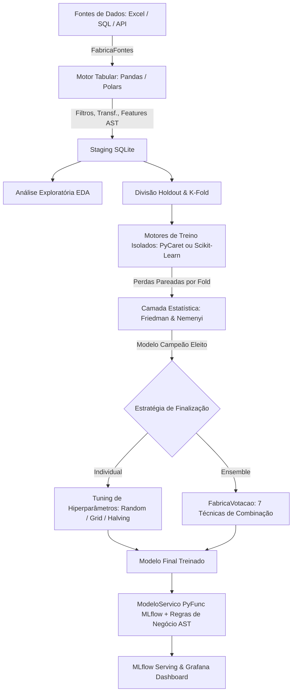
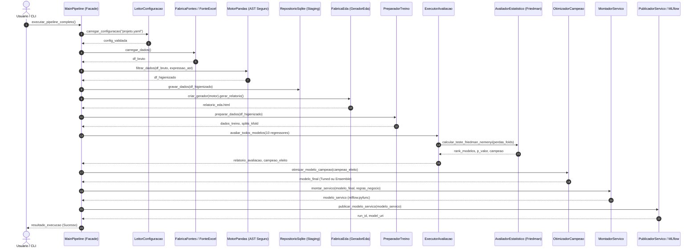
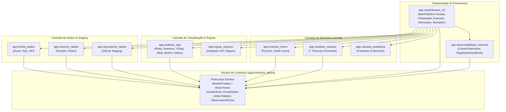
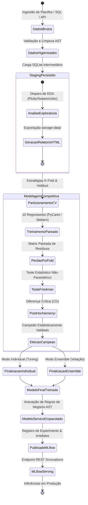

# Documentação Técnica e Arquitetural — Machine Learning Apartamentos Ribeirão Preto

## 1. Visão Geral e Arquitetura do Sistema

Este projeto implementa uma solução corporativa de alta performance para previsão de preços de apartamentos em Ribeirão Preto - SP. A arquitetura foi desenvolvida seguindo os princípios de engenharia de software **SOLID**, separação de conceitos através de **GoF Patterns** (Factory, Adapter, Strategy, Facade) e contratos estritos via `typing.Protocol`, com tipagem estática rigorosa em **Python 3.12+** sem o uso de `typing.Any` ou `object`.

### Diagrama Arquitetural de Fluxo de Dados



### Principais Decisões Arquiteturais
- **Sem FastAPI**: O modelo treinado é empacotado através do `ModeloServico` herdando de `mlflow.pyfunc.PythonModel`, permitindo deploy nativo e conteinerizado via `mlflow models serve`.
- **Isolamento Físico de Frameworks**: A trilha PyCaret utiliza exclusivamente suas funções nativas (`RegressionExperiment`, `create_model`, `tune_model`, `finalize_model`), enquanto a trilha Scikit-Learn opera de forma 100% desacoplada com `Pipeline`, `ColumnTransformer` e buscas nativas.
- **Segurança de Execução (AST)**: Nenhuma configuração em YAML executa comandos `eval` ou `exec` arbitrários. Expressões de filtros, transformações e regras de negócio passam por um interpretador de AST (Abstract Syntax Tree) restritivo com lista positiva de operadores e funções vetorizadas.

---

## 2. Modelagem UML Completa do Sistema (Arquitetura & Engenharia)

Para garantir governança técnica, manutenibilidade de longo prazo e comunicação inequívoca entre os papéis do time (PM, ML Architect, Data Engineer, ML Engineer e DevOps), a engenharia do projeto foi formalmente modelada através de diagramas da **UML 2.5 (Unified Modeling Language)** com especificação Mermaid.

> [!TIP]
> **Interatividade no Navegador e Super Zoom até 1000% (10x):** Na documentação em HTML ([`docs/documentacao_projeto.html`](file:///home/rodrigo/PycharmProjects/machine_learning_apartamentos_rp_pycarret/docs/documentacao_projeto.html) e [`docs/index.html`](file:///home/rodrigo/PycharmProjects/machine_learning_apartamentos_rp_pycarret/docs/index.html)), cada diagrama dispõe de barra de ferramentas com **Zoom In (➕)**, **Zoom Out (➖)**, **Atalho 1000%**, **Reset (↺)**, **Zoom Contínuo via Scroll do Mouse (até 1000%)**, **Pan (clicar e arrastar)**, **Alternância Rápida de Escalas** e **Modo Tela Cheia (⛶ Lightbox)**.

### 2.1. Diagrama de Classes UML — Padrões GoF, Protocolos e Subsistemas

Mapeamento completo das interfaces semânticas (`Protocol`), hierarquia de geradores de EDA (6 motores desacoplados: Plotly, Sweetviz, YData Profiling, Altair, Bokeh e Nativo), facade modular do pipeline e subsistema reativo de observabilidade:

```mermaid
classDiagram
    direction TB

    %% Contratos e Protocolos
    class GeradorEda {
        <<Protocol>>
        +gerar_relatorio(dados, coluna_alvo, caminho_saida, analises) str
    }
    class MotorTreino {
        <<Protocol>>
        +executar_validacao_cruzada(dados, config) dict
        +treinar_modelo_final(dados, config) ModeloPreditor
    }
    class ModeloPreditor {
        <<Protocol>>
        +predict(x) ndarray
    }
    class FonteDados {
        <<Protocol>>
        +carregar_dados() DataFrame
    }
    class MotorTabela {
        <<Protocol>>
        +filtrar_dados(df, expressao) DataFrame
        +transformar_dados(df, expressao, coluna) DataFrame
    }
    class ObservadorMLflow {
        <<Protocol>>
        +notificar_sucesso(dados_evento) None
        +notificar_falha(dados_evento) None
    }

    %% Subsistema EDA
    class FabricaEda {
        +criar_gerador(motor: str, motor_tabular: str) GeradorEda
    }
    class GeradorPlotly {
        -construtor_tabela: ConstrutorTabela
        -construtor_layout: ConstrutorLayout
        -motor_tabela: MotorTabela
        +gerar_relatorio(...) str
    }
    class GeradorSweetviz {
        +gerar_relatorio(...) str
    }
    class GeradorYData {
        -_corrigir_layout_tabelas(html: str) str
        +gerar_relatorio(...) str
    }
    class GeradorAltair {
        -motor_tabela: MotorTabela
        +gerar_relatorio(...) str
    }
    class GeradorBokeh {
        -motor_tabela: MotorTabela
        +gerar_relatorio(...) str
    }
    class GeradorNativo {
        -motor_tabela: MotorTabela
        +gerar_relatorio(...) str
    }

    GeradorEda <|.. GeradorPlotly : implements
    GeradorEda <|.. GeradorSweetviz : implements
    GeradorEda <|.. GeradorYData : implements
    GeradorEda <|.. GeradorAltair : implements
    GeradorEda <|.. GeradorBokeh : implements
    GeradorEda <|.. GeradorNativo : implements
    FabricaEda ..> GeradorEda : creates
    FabricaEda ..> FabricaMotores : resolves engine via
    GeradorPlotly ..> MotorTabela : evaluates AST via
    GeradorAltair ..> MotorTabela : evaluates AST via
    GeradorBokeh ..> MotorTabela : evaluates AST via
    GeradorNativo ..> MotorTabela : evaluates AST via
    MotorTabela <|.. MotorPandas : implements
    MotorTabela <|.. MotorPolars : implements

    %% Subsistema Orquestracao (Facade & Especialistas)
    class MainPipeline {
        <<Facade>>
        -preparador: PreparadorTreino
        -executor: ExecutorAvaliacao
        -otimizador: OtimizadorCampeao
        -montador: MontadorServico
        +executar_pipeline_completo() dict
        +executar_apenas_eda() str
    }
    class PreparadorTreino {
        +preparar_dados(df, config) tuple
    }
    class ExecutorAvaliacao {
        +avaliar_todos_modelos(dados, config) dict
    }
    class OtimizadorCampeao {
        +otimizar_modelo_campeao(dados, config) ModeloPreditor
    }
    class MontadorServico {
        +montar_servico(modelo, config) ModeloServico
    }

    MainPipeline *-- PreparadorTreino : aggregates
    MainPipeline *-- ExecutorAvaliacao : aggregates
    MainPipeline *-- OtimizadorCampeao : aggregates
    MainPipeline *-- MontadorServico : aggregates

    %% Motores de Treino e Ensembles
    class MotorPyCaret {
        +executar_validacao_cruzada(...) dict
        +treinar_modelo_final(...) ModeloPreditor
    }
    class MotorSklearn {
        +executar_validacao_cruzada(...) dict
        +treinar_modelo_final(...) ModeloPreditor
    }
    MotorTreino <|.. MotorPyCaret : implements
    MotorTreino <|.. MotorSklearn : implements

    class RegressorVotacao {
        <<Composite>>
        -modelos: list~ModeloPreditor~
        +predict(x) ndarray
    }
    class FabricaVotacao {
        +criar_votador(tipo: str, modelos: list) ModeloPreditor
    }
    ModeloPreditor <|.. RegressorVotacao : implements
    RegressorVotacao o-- ModeloPreditor : contains
    FabricaVotacao ..> ModeloPreditor : creates

    %% Observabilidade
    class PublicadorServico {
        <<Subject>>
        -observadores: list~ObservadorMLflow~
        +registrar_observador(obs) None
        +publicar_modelo_servico(...) None
    }
    class ColetorTelemetria {
        +notificar_sucesso(...) None
    }
    class RegistradorAuditoria {
        +notificar_sucesso(...) None
    }
    ObservadorMLflow <|.. ColetorTelemetria : implements
    ObservadorMLflow <|.. RegistradorAuditoria : implements
    PublicadorServico o-- ObservadorMLflow : notifies
```



### 2.2. Diagrama de Sequência UML — Ciclo de Execução Ponta a Ponta

Interação temporal entre os subsistemas desde a invocação do pipeline, validação de AST, staging SQLite, testes estatísticos até a disponibilização do endpoint REST:



### 2.3. Diagrama de Pacotes & Componentes UML — Arquitetura Modular em `app/`

Organização modular dos pacotes em `app/`, demonstrando a ausência de dependências cíclicas e o isolamento através de protocolos centrais:



### 2.4. Diagrama de Estados UML — Ciclo de Vida do Dado e do Modelo

Transições de estado do pipeline analítico, desde a ingestão da fonte externa até o serviço operacional no MLflow Serving:



### 2.5. Diagrama de Atividades UML — Fluxo de Engenharia & Decisão Ponta a Ponta

Mapeamento exaustivo de **atividades, decisões lógicas, bifurcações condicionais e raias de responsabilidade** em todo o ciclo de vida do pipeline preditivo — da chamada CLI até a ativação da API REST:

```mermaid
flowchart TD
    %% Nós Iniciais e Gatilhos
    Start((● Início)) --> Invocacao["Disparo do Pipeline<br><b>./executar_treinamento.sh</b><br><i>Flags: --modo, --modelo, --subir-api, --porta</i>"]

    %% Raia 1: Leitura e Validacao Pydantic
    subgraph S1 ["1. Governança e Configuração (LeitorConfiguracao)"]
        Invocacao --> LerYAML["Carregar <b>configuracoes/projeto.yaml</b><br>Interpolação de variáveis: ${IMOVEIS_XLSX_PATH}, etc."]
        LerYAML --> ValidarSchema{"Validação Estrita<br>Pydantic & StrEnums<br>Python 3.12+?"}
        ValidarSchema -- "❌ Inválido / Chave Desconhecida" --> ErroConfig["Lançar ErroConfiguracao<br>(Fail-Fast com causa raiz)"] --> FimErro((✕ Interrupção))
        ValidarSchema -- "✅ Válido" --> ConfigPronta["Configuração Validada e<br>Normalizada em Tipos Enumerados"]
    end

    %% Raia 2: Engenharia de Dados & Staging
    subgraph S2 ["2. Engenharia de Dados & Staging SQLite (FabricaFontes / MotorTabela)"]
        ConfigPronta --> CargaFonte["Ingestão Polimórfica (Excel / SQL / API)<br><b>FabricaFontes.obter_provedor()</b>"]
        CargaFonte --> SanitizacaoAST["Higienização Tabular via AST Restrito<br>• Filtros lógicos declarativos<br>• Transformações in-place: clip()<br>• Feature Engineering: novos atributos"]
        SanitizacaoAST --> DespachoMotor{"Despacho do Motor Tabular<br><b>tabular.motor</b>?"}
        DespachoMotor -- "pandas" --> ExecPandas["Processamento Vetorizado Pandas<br><b>MotorPandas.transformar_dados()</b>"]
        DespachoMotor -- "polars" --> ExecPolars["Processamento Vetorizado Polars (Rust)<br><b>MotorPolars.transformar_dados()</b>"]
        ExecPandas --> SalvarStaging["Persistência Intermediária Congelada<br><b>RepositorioSqlite(staging_imoveis.db)</b>"]
        ExecPolars --> SalvarStaging
    end

    %% Raia 3: Roteamento de Modo de Execução
    subgraph S3 ["3. Roteamento de Modo de Execução"]
        SalvarStaging --> RotaModo{"Qual o Modo<br>de Execução Selecionado?"}
    end

    %% Ramo EDA
    subgraph S_EDA ["Trilha A: Análise Exploratória (Apenas EDA)"]
        RotaModo -- "--apenas-eda" --> InstanciarEDA["FabricaEda.criar_gerador(motor, motor_tabular)<br>Plotly | Sweetviz | YData | Altair | Bokeh | Nativo"]
        InstanciarEDA --> GerarGraficos["Renderização de Gráficos e Tabelas Declarativas<br>Histogramas, Boxplots, Dispersão, Correlação e Rankings"]
        GerarGraficos --> ExportarRelatorios["Exportar Relatório Visual e Sumário Estatístico<br><b>storage-data/relatorio_eda.html & json</b>"]
        ExportarRelatorios --> FimEDA((● Fim EDA))
    end

    %% Ramo Apenas Campeão
    subgraph S_Campeao ["Trilha B: Modo Rápido (~14s / Apenas Campeão)"]
        RotaModo -- "--apenas-campeao" --> ObterCampeao["Recuperar Último Campeão do MLflow Registry<br>(ou fallback configurado: random_forest)"]
        ObterCampeao --> TreinoDiretoCampeao["Ajustar Imputação e Codificação One-Hot<br>Treinar Estimador Único na Base Total de Staging<br><i>Transformação do Alvo: log1p(y)</i>"]
    end

    %% Ramo Benchmark Completo
    subgraph S_Benchmark ["Trilha C: Modo Completo (Benchmark Formal)"]
        RotaModo -- "--modo completo" --> HoldoutSplit["Segregação de Holdout Cego (20%)<br>Preservação estrita sem vazamento de dados"]
        HoldoutSplit --> CriarFolds["Validação Cruzada Externa Pareada<br>Repeated K-Fold (5 splits x 3 repetições = 15 folds)"]
        CriarFolds --> TreinoPareado["Treinamento Pareado dos 10 Modelos de Regressão<br>Linear, Lasso, Ridge, ElasticNet, DecisionTree,<br>RandomForest, SVR, MLP, XGBoost, LightGBM"]
        TreinoPareado --> MatrizPerdas["Matriz Pareada de Resíduos e RMSE por Fold"]
        MatrizPerdas --> TesteFriedman["Teste Não-Paramétrico Global de Friedman<br>Cálculo da Estatística qui-quadrado e P-Valor"]
        TesteFriedman --> Significativo{"Diferença Estatística<br>Significativa (p < 0.05)?"}
        Significativo -- "Sim" --> PostHocNemenyi["Pós-Teste de Nemenyi<br>Cálculo da Diferença Crítica (CD) e Postos"]
        Significativo -- "Não" --> DesempateRMSE["Aplicação do Critério de Desempate<br>(Menor RMSE Médio nos 15 Folds)"]
        PostHocNemenyi --> ElegerCampeao["Eleição Formal do Modelo Campeão Estatístico"]
        DesempateRMSE --> ElegerCampeao
        ElegerCampeao --> DecisaoOtimizacao{"Estratégia de Finalização<br>do Modelo?"}
        DecisaoOtimizacao -- "Votação / Ensemble (7 Técnicas)" --> MontarVotador["FabricaVotacao.criar_votador()<br>Media Simples | Ponderada RMSE | Stacking | etc."]
        DecisaoOtimizacao -- "Tuning de Hiperparâmetros" --> ExecutarTuning["Otimização de Hiperparâmetros (CV interna)<br>Random | Bayesian | Optuna | Grid"]
        DecisaoOtimizacao -- "Padrão Calibrado" --> TreinarVencedor["Treinamento Final do Estimador<br>na Base Completa de Treino"]
        MontarVotador --> EstimadorFinalPronto["Estimador Vencedor Congelado"]
        ExecutarTuning --> EstimadorFinalPronto
        TreinarVencedor --> EstimadorFinalPronto
    end

    %% Raia 4: Empacotamento de Regras de Negocio
    subgraph S4 ["4. Empacotamento & Regras de Negócio (MontadorServico)"]
        TreinoDiretoCampeao --> EnveloparServico
        EstimadorFinalPronto --> EnveloparServico["Envelopar Estimador no <b>ModeloServico</b><br>Wrapper mlflow.pyfunc.PythonModel"]
        EnveloparServico --> AnexarRegras["Anexar Avaliador de Regras de Negócio em AST:<br>1. Margem Inferior de Negociação (Piso -5%)<br>2. Margem Superior de Listagem (Teto +5%)<br>3. Preço Estimado por m² de Área Privativa<br>4. Estimativa de Comissão CRECI-SP (6%)"]
        AnexarRegras --> ReversaoEscala["Injetar Reversão Automática de Escala:<br><b>y = expm1(y_pred)</b> para retorno em Reais (R$)"]
    end

    %% Raia 5: Publicacao e MLflow Serving
    subgraph S5 ["5. Publicação, Observabilidade e Serving (PublicadorServico / MLflow)"]
        ReversaoEscala --> LogMLflow["Registrar Parâmetros, Métricas e Artefatos no MLflow Tracking<br>Curvas Viés-Variância, Folds Pareados e Resíduos"]
        LogMLflow --> NotificarObservers["Notificar Observadores GoF Observer:<br>• ObservadorAuditoria (storage-data/auditoria_mlflow.jsonl)<br>• ObservadorMetricas (Prometheus storage-data/metricas_mlflow.prom)"]
        NotificarObservers --> RegistrarModelRegistry["Registrar Nova Versão no MLflow Model Registry<br><b>previsao_preco_imoveis</b> (Versão Produção)"]
        RegistrarModelRegistry --> SubirServing{"Flag <b>--subir-api</b><br>ou <b>subir_api_serving: true</b>?"}
        SubirServing -- "Sim" --> InicializarServidor["Inicializar / Recarregar Servidor MLflow Serving<br>Host 0.0.0.0 | Porta 8080 | Endpoint /invocations"]
        SubirServing -- "Não" --> FinalizarSemServidor["Concluir Execução mantendo Modelo no Registry"]
        InicializarServidor --> ServicoAtivo["API de Inferência Operacional<br>Pronta para Consumo por CRMs e Corretores"]
        ServicoAtivo --> FimSucesso((● Fim Sucesso))
        FinalizarSemServidor --> FimSucesso
    end
```



---


## 3. Catálogo Completo dos Padrões de Projeto GoF (Gang of Four)

Para afastar o anti-padrão de scripts monolíticos e códigos experimentais desestruturados em Machine Learning, a engenharia do projeto foi desenhada a partir de padrões consagrados do **Gang of Four (GoF)**. O sistema utiliza composição sobre herança, polimorfismo estrutural através de contratos estritos (`typing.Protocol`), inversão de dependência e desacoplamento físico total entre bibliotecas.

### 3.1. Matriz de Padrões GoF Implementados

| Padrão GoF | Família | Componentes / Classes | Arquivo no Repositório | Contrato / Protocolo | Papel Arquitetural e Regra Atendida |
| :--- | :--- | :--- | :--- | :--- | :--- |
| **Factory Method / Factory** | **Criacional** | [`FabricaFontes`](file:///home/rodrigo/PycharmProjects/machine_learning_apartamentos_rp_pycarret/app/fontes_dados/fabrica_fontes.py)<br>[`FabricaMotores`](file:///home/rodrigo/PycharmProjects/machine_learning_apartamentos_rp_pycarret/app/motores_tabela/fabrica_motores.py)<br>[`FabricaVotacao`](file:///home/rodrigo/PycharmProjects/machine_learning_apartamentos_rp_pycarret/app/modelos_votacao/fabrica_votacao.py)<br>[`FabricaEda`](file:///home/rodrigo/PycharmProjects/machine_learning_apartamentos_rp_pycarret/app/analises_eda/fabrica_eda.py)<br>[`PreparadorTreino`](file:///home/rodrigo/PycharmProjects/machine_learning_apartamentos_rp_pycarret/app/orquestracao_ml/preparador_treino.py) | `app/fontes_dados/`<br>`app/motores_tabela/`<br>`app/modelos_votacao/`<br>`app/analises_eda/`<br>`app/orquestracao_ml/` | `FonteDados`<br>`MotorTabela`<br>`ModeloPreditor`<br>`GeradorEda`<br>`MotorTreino` | Instanciação dinâmica baseada 100% no arquivo `projeto.yaml`, sem expor construtores concretos ao cliente. |
| **Builder / Construtores** | **Criacional** | [`ConstrutorTabela`](file:///home/rodrigo/PycharmProjects/machine_learning_apartamentos_rp_pycarret/app/analises_eda/construtor_tabela.py)<br>[`ConstrutorLayout`](file:///home/rodrigo/PycharmProjects/machine_learning_apartamentos_rp_pycarret/app/analises_eda/construtor_layout.py)<br>[`MontadorServico`](file:///home/rodrigo/PycharmProjects/machine_learning_apartamentos_rp_pycarret/app/orquestracao_ml/montador_servico.py) | `app/analises_eda/`<br>`app/orquestracao_ml/` | `go.Figure`<br>`HTML Template`<br>`ModeloServico` | Constrói representações complexas (tabelas formatadas com agrupamento, páginas completas em Dark Mode e serviço empacotado para MLflow). |
| **Adapter (Wrapper)** | **Estrutural** | [`MotorSklearn`](file:///home/rodrigo/PycharmProjects/machine_learning_apartamentos_rp_pycarret/app/motores_treino/motor_sklearn.py)<br>[`MotorPycaret`](file:///home/rodrigo/PycharmProjects/machine_learning_apartamentos_rp_pycarret/app/motores_treino/motor_pycaret.py)<br>[`FonteExcel`](file:///home/rodrigo/PycharmProjects/machine_learning_apartamentos_rp_pycarret/app/fontes_dados/fonte_excel.py)<br>[`ModeloServico`](file:///home/rodrigo/PycharmProjects/machine_learning_apartamentos_rp_pycarret/app/orquestracao_ml/modelo_servico.py) | `app/motores_treino/`<br>`app/fontes_dados/`<br>`app/orquestracao_ml/` | `MotorTreino`<br>`FonteDados`<br>`mlflow.pyfunc.PythonModel` | Unifica APIs externas divergentes (Scikit-Learn x PyCaret; pandas/openpyxl; MLflow Serving) sob interfaces padronizadas de domínio. |
| **Composite** | **Estrutural** | [`RegressorVotacao`](file:///home/rodrigo/PycharmProjects/machine_learning_apartamentos_rp_pycarret/app/modelos_votacao/regressor_votacao.py) | `app/modelos_votacao/` | `ModeloPreditor` | Trata comitês heterogêneos de regressores (Random Forest, XGBoost, etc.) como se fossem um único objeto `ModeloPreditor`. |
| **Facade** | **Estrutural** | [`MainPipeline`](file:///home/rodrigo/PycharmProjects/machine_learning_apartamentos_rp_pycarret/app/orquestracao_ml/main_pipeline.py)<br>*(Especialistas: [`ExecutorAvaliacao`](file:///home/rodrigo/PycharmProjects/machine_learning_apartamentos_rp_pycarret/app/orquestracao_ml/executor_avaliacao.py), [`OtimizadorCampeao`](file:///home/rodrigo/PycharmProjects/machine_learning_apartamentos_rp_pycarret/app/orquestracao_ml/otimizador_campeao.py))* | `app/orquestracao_ml/` | Pipeline de Execução | Ponto único de alto nível que simplifica e orquestra a complexidade de subsistemas integrados (ingestão, staging, EDA, CV pareada, Friedman, regras e deploy). |
| **Strategy** | **Comportamental** | [`MotorPandas`](file:///home/rodrigo/PycharmProjects/machine_learning_apartamentos_rp_pycarret/app/motores_tabela/motor_pandas.py) vs [`MotorPolars`](file:///home/rodrigo/PycharmProjects/machine_learning_apartamentos_rp_pycarret/app/motores_tabela/motor_polars.py)<br>Motores de Treino<br>Particionadores de CV (5 tipos)<br>Técnicas de Votação (7 tipos)<br>Motores de EDA ([`GeradorSweetviz`](file:///home/rodrigo/PycharmProjects/machine_learning_apartamentos_rp_pycarret/app/analises_eda/gerador_sweetviz.py), [`GeradorPlotly`](file:///home/rodrigo/PycharmProjects/machine_learning_apartamentos_rp_pycarret/app/analises_eda/gerador_plotly.py), [`GeradorNativo`](file:///home/rodrigo/PycharmProjects/machine_learning_apartamentos_rp_pycarret/app/analises_eda/gerador_nativo.py)) | `app/motores_tabela/`<br>`app/motores_treino/`<br>`app/modelos_votacao/`<br>`app/analises_eda/` | `MotorTabela`<br>`MotorTreino`<br>Contratos Matemáticos<br>`GeradorEda` | Famílias de algoritmos intercambiáveis em tempo de execução via configuração (vetorização, split, ensemble e visualização de EDA). |
| **Observer** | **Comportamental** | [`PublicadorServico`](file:///home/rodrigo/PycharmProjects/machine_learning_apartamentos_rp_pycarret/app/orquestracao_ml/publicador_servico.py) (Subject)<br>[`ColetorTelemetria`](file:///home/rodrigo/PycharmProjects/machine_learning_apartamentos_rp_pycarret/app/observabilidade_metricas/coletor_telemetria.py)<br>[`RegistradorAuditoria`](file:///home/rodrigo/PycharmProjects/machine_learning_apartamentos_rp_pycarret/app/observabilidade_metricas/registrador_auditoria.py) | `app/observabilidade_metricas/`<br>`app/orquestracao_ml/` | [`ObservadorMLflow`](file:///home/rodrigo/PycharmProjects/machine_learning_apartamentos_rp_pycarret/app/contratos_dados/observador_mlflow.py) | Emissão reativa e desacoplada de eventos de publicação e deploy no MLflow para auditoria imutável (JSONL) e telemetria operacional (Prometheus/Grafana). |
| **Interpreter** | **Comportamental** | [`AvaliadorRegras`](file:///home/rodrigo/PycharmProjects/machine_learning_apartamentos_rp_pycarret/app/regras_negocio/avaliador_regras.py) | `app/regras_negocio/` | AST Visitor Seguro | Avalia expressões matemáticas de filtros e regras de negócio diretamente na árvore sintática abstrata (AST), sem invocar `eval()` ou `exec()`. |
| **Repository** | **Persistência** | [`RepositorioSqlite`](file:///home/rodrigo/PycharmProjects/machine_learning_apartamentos_rp_pycarret/app/repositorios_dados/repositorio_sqlite.py) | `app/repositorios_dados/` | `RepositorioDados` | Isola as operações de persistência intermediária em banco de dados relacional (SQLite staging) das regras analíticas. |

---

### 3.2. Detalhamento dos Padrões por Família

#### 1. Padrões Criacionais (Creational)
- **`FabricaFontes`**: Abstrai a criação de fontes heterogêneas (`FonteExcel`, `FonteSql`, `FonteApi`). Permite migrar a ingestão de uma planilha de apartamentos para uma API imobiliária REST alterando apenas a chave `tipo_fonte` do `projeto.yaml`.
- **`FabricaMotores`**: Instancia dinamicamente o motor de processamento tabular (`MotorPandas` ou `MotorPolars`), garantindo que o resto da aplicação interaja exclusivamente com a interface semântica `MotorTabela`.
- **`FabricaVotacao`**: Constrói instâncias dos 7 comitês de votação (Média Simples, Ponderada por R², Mediana, Rank Average, Trimmed Mean, Stacking Linear ou Voting Nativo).
- **`FabricaEda`**: Instancia dinamicamente o motor de visualização e geração de relatórios de EDA (`GeradorSweetviz`, `GeradorPlotly`, `GeradorNativo`) a partir da chave declarativa `eda.motor` no arquivo `projeto.yaml`.

#### 2. Padrões Estruturais (Structural)
- **`Adapter (Wrapper)` nos Motores de Treino**:
  - O PyCaret baseia-se em uma máquina de estados procedural (`RegressionExperiment`, `setup`, `create_model`, `pull`).
  - O Scikit-Learn opera com transformadores colunares, pipelines orientados a objetos e estimadores encapsulados.
  - Os adaptadores `MotorSklearn` e `MotorPycaret` implementam o contrato `MotorTreino`, permitindo alternar de framework no arquivo YAML sem alterar o orquestrador do pipeline.
- **`Adapter` no `ModeloServico` para MLflow**:
  - Adapta o estimador final treinado e o avaliador de regras de negócio AST para a classe padrão `mlflow.pyfunc.PythonModel`. A inferência no endpoint `/invocations` executa o modelo estatístico e em seguida calcula dinamicamente todas as colunas de pós-processamento configuradas no YAML.
- **`Composite` no `RegressorVotacao`**:
  - Agrupa uma coleção heterogênea de objetos `ModeloPreditor` (ex: Random Forest, XGBoost e LightGBM). Ao chamar `predizer(dados)`, o composite distribui as inferências aos componentes e agrega os resultados conforme a estratégia selecionada.
- **`Facade` no `MainPipeline`**:
  - Fachada unificada que oculta a interação com 10 subsistemas de dados, modelagem e infraestrutura (Ingestão -> Staging -> EDA -> Split -> Motores -> Friedman/Nemenyi -> Ensemble -> Diagnóstico -> Regras -> MLflow).

#### 3. Padrões Comportamentais (Behavioral)
- **`Strategy`**:
  - Motores Tabulares: Estratégias vetorizadas intercambiáveis (`MotorPandas` vs `MotorPolars`).
  - Validação Cruzada: Estratégias de particionamento amostral (`KFold`, `RepeatedKFold`, `StratifiedKFold`, `GroupKFold`, `TimeSeriesSplit`).
  - Combinação Preditiva: 7 estratégias matemáticas de consenso para cálculo do valor do imóvel.
  - Motores de EDA: Estratégias desacopladas sob o contrato `GeradorEda` (`GeradorSweetviz` para AutoEDA automatizado rico, `GeradorPlotly` para painéis interativos HTML e `GeradorNativo` para relatórios estatísticos sem dependências adicionais).
- **`Observer`**:
  - O `PublicadorServico` (Subject) notifica observadores que implementam `ObservadorMLflow` após cada operação de publicação.
  - `ObservadorAuditoria`: Persiste um registro imutável em JSONL (`auditoria_publicacoes.jsonl`) com timestamp, run_id, autor, status e métricas.
  - `ObservadorMetricas`: Atualiza contadores e histogramas para observabilidade e telemetria (compatível com Prometheus e Grafana).
- **`Interpreter`**:
  - O `AvaliadorRegras` implementa um interpretador recursivo de nós AST autorizados (`ast.BinOp`, `ast.UnaryOp`, `ast.Compare`, etc.). Garante conformidade estrita com a regra de segurança do projeto, impedindo injeção de código arbitrário.
- **`Repository`**:
  - O `RepositorioSqlite` desacopla a persistência em banco relacional SQLite intermediário da lógica analítica e de machine learning.

### 3.3. Mapeamento Modular e Separação de Arquivos em `app/`

Em estrita conformidade com o **Single Responsibility Principle (SRP)**, alta coesão e as regras de governança do projeto (**módulos e pacotes próprios com duas palavras separadas por `_`** e **uma classe principal por arquivo**), o código de produto em `app/` foi totalmente modularizado:

| Pacote | Arquivo (.py) | Classe Principal | Responsabilidade Única |
| :--- | :--- | :--- | :--- |
| `app/analises_eda/` | [`fabrica_eda.py`](file:///home/rodrigo/PycharmProjects/machine_learning_apartamentos_rp_pycarret/app/analises_eda/fabrica_eda.py) | `FabricaEda` | Factory Method dos motores de EDA (`GeradorPlotly`, `GeradorSweetviz`, `GeradorNativo`). |
| `app/analises_eda/` | [`gerador_plotly.py`](file:///home/rodrigo/PycharmProjects/machine_learning_apartamentos_rp_pycarret/app/analises_eda/gerador_plotly.py) | `GeradorPlotly` | Orquestração do EDA interativo Plotly processando filtros e cálculos declarativos. |
| `app/analises_eda/` | [`construtor_tabela.py`](file:///home/rodrigo/PycharmProjects/machine_learning_apartamentos_rp_pycarret/app/analises_eda/construtor_tabela.py) | `ConstrutorTabela` | Constrói e formata componentes interativos `go.Table` (agrupamentos, métricas e ranking). |
| `app/analises_eda/` | [`construtor_layout.py`](file:///home/rodrigo/PycharmProjects/machine_learning_apartamentos_rp_pycarret/app/analises_eda/construtor_layout.py) | `ConstrutorLayout` | Monta documento HTML responsivo em Dark Mode com cards e metadados estatísticos. |
| `app/orquestracao_ml/` | [`main_pipeline.py`](file:///home/rodrigo/PycharmProjects/machine_learning_apartamentos_rp_pycarret/app/orquestracao_ml/main_pipeline.py) | `MainPipeline` | Facade de alto nível coordenando ingestão, staging, EDA, modelagem e serving. |
| `app/orquestracao_ml/` | [`preparador_treino.py`](file:///home/rodrigo/PycharmProjects/machine_learning_apartamentos_rp_pycarret/app/orquestracao_ml/preparador_treino.py) | `PreparadorTreino` | Instancia e parametriza o motor de treino isolado (Scikit-Learn ou PyCaret) a partir do YAML. |
| `app/orquestracao_ml/` | [`executor_avaliacao.py`](file:///home/rodrigo/PycharmProjects/machine_learning_apartamentos_rp_pycarret/app/orquestracao_ml/executor_avaliacao.py) | `ExecutorAvaliacao` | Executa validação cruzada pareada de todos os modelos e inferência de Friedman/Nemenyi. |
| `app/orquestracao_ml/` | [`otimizador_campeao.py`](file:///home/rodrigo/PycharmProjects/machine_learning_apartamentos_rp_pycarret/app/orquestracao_ml/otimizador_campeao.py) | `OtimizadorCampeao` | Conduz tuning de hiperparâmetros ou ensemble ponderado/simples para o campeão. |
| `app/orquestracao_ml/` | [`montador_servico.py`](file:///home/rodrigo/PycharmProjects/machine_learning_apartamentos_rp_pycarret/app/orquestracao_ml/montador_servico.py) | `MontadorServico` | Monta o `ModeloServico` (PyFunc MLflow) envelopando o modelo final com regras de negócio AST. |
| `app/orquestracao_ml/` | [`publicador_servico.py`](file:///home/rodrigo/PycharmProjects/machine_learning_apartamentos_rp_pycarret/app/orquestracao_ml/publicador_servico.py) | `PublicadorServico` | Subject Observer que registra e publica o modelo no MLflow Model Registry. |
| `app/observabilidade_metricas/`| [`coletor_telemetria.py`](file:///home/rodrigo/PycharmProjects/machine_learning_apartamentos_rp_pycarret/app/observabilidade_metricas/coletor_telemetria.py)| `ColetorTelemetria` | Observer que coleta métricas operacionais e exporta formato Prometheus/Grafana. |
| `app/observabilidade_metricas/`| [`registrador_auditoria.py`](file:///home/rodrigo/PycharmProjects/machine_learning_apartamentos_rp_pycarret/app/observabilidade_metricas/registrador_auditoria.py)| `RegistradorAuditoria` | Observer que grava trilha de auditoria e governança de modelos em JSONL. |
| `app/regras_negocio/` | [`avaliador_regras.py`](file:///home/rodrigo/PycharmProjects/machine_learning_apartamentos_rp_pycarret/app/regras_negocio/avaliador_regras.py) | `AvaliadorRegras` | Interpreter AST seguro com lista positiva de operadores e funções vetorizadas. |
| `app/fontes_dados/` | [`fabrica_fontes.py`](file:///home/rodrigo/PycharmProjects/machine_learning_apartamentos_rp_pycarret/app/fontes_dados/fabrica_fontes.py) | `FabricaFontes` | Factory Method para instanciar fontes polimórficas (Excel, SQL, API). |
| `app/motores_tabela/` | [`fabrica_motores.py`](file:///home/rodrigo/PycharmProjects/machine_learning_apartamentos_rp_pycarret/app/motores_tabela/fabrica_motores.py) | `FabricaMotores` | Factory Method dos motores tabulares (Pandas vetorizado ou Polars lazy). |
| `app/modelos_votacao/` | [`fabrica_votacao.py`](file:///home/rodrigo/PycharmProjects/machine_learning_apartamentos_rp_pycarret/app/modelos_votacao/fabrica_votacao.py) | `FabricaVotacao` | Factory Method dos 7 comitês de votação e ensemble preditivo. |
| `app/repositorios_dados/` | [`repositorio_sqlite.py`](file:///home/rodrigo/PycharmProjects/machine_learning_apartamentos_rp_pycarret/app/repositorios_dados/repositorio_sqlite.py) | `RepositorioSqlite` | Repositório de staging relacional intermediário. |
| `app/tipos_enumerados/` | [`enumeradores_sistema.py`](file:///home/rodrigo/PycharmProjects/machine_learning_apartamentos_rp_pycarret/app/tipos_enumerados/enumeradores_sistema.py) | `TipoModelo`, `TipoEscalonador`, `TipoCodificador`, etc. | Enumerações fortemente tipadas (`StrEnum`) eliminando strings mágicas no pipeline. |

---

## 4. Camada Estatística Independente: Testes de Friedman e Nemenyi

Para evitar viés empírico e escolhas arbitrárias na seleção de modelos preditivos, o projeto adota o protocolo estatístico recomendado por Janez Demšar (*Statistical Comparisons of Classifiers over Multiple Data Sets*, JMLR 2006).

### 4.1. O Teste Não-Paramétrico de Friedman
O teste de Friedman é um teste estatístico não-paramétrico pareado (análogo à ANOVA de medidas repetidas), utilizado para comparar $k$ algoritmos de machine learning sobre $N$ blocos de validação (folds da validação cruzada pareada):

1. **Hipótese Nula ($H_0$)**: Todos os algoritmos apresentam desempenhos equivalentes e suas ordens de postos médios decorrem do acaso.
2. **Procedimento de Postos**: Em cada fold $i \in \{1, \dots, N\}$, os modelos são ranqueados pelo seu erro (RMSE). O melhor modelo recebe posto $r_i^j = 1$, o segundo melhor $r_i^j = 2$, e assim sucessivamente.
3. **Posto Médio**:
   $$R_j = \frac{1}{N} \sum_{i=1}^N r_i^j$$
4. **Estatística do Teste**:
   $$\chi_F^2 = \frac{12N}{k(k+1)} \left[ \sum_{j=1}^k R_j^2 - \frac{k(k+1)^2}{4} \right]$$
   Sob a hipótese nula, $\chi_F^2$ segue uma distribuição qui-quadrado com $k - 1$ graus de liberdade.

### 4.2. Pós-Teste de Nemenyi e Diferença Crítica (CD)
Quando o teste de Friedman rejeita a hipótese nula ao nível de significância $\alpha = 0.05$, aplica-se o pós-teste de Nemenyi para identificar quais pares de modelos diferem de forma estatisticamente significante.

Dois modelos são considerados estatisticamente diferentes se a distância entre seus postos médios for superior à **Diferença Crítica (Critical Difference - CD)**:
$$CD = q_\alpha \sqrt{\frac{k(k+1)}{6N}}$$
Onde $q_\alpha$ é o valor crítico da distribuição da amplitude studentizada normalizada.
O modelo que obtiver o **menor posto médio** (menor perda média) é eleito o **Modelo Campeão Estatístico**.

---

## 5. Pré-Processamento Avançado e Engenharia de Atributos

O sistema suporta transformação matemática e tratamento de dados ausentes configurável de forma 100% declarativa no [configuracoes/projeto.yaml](file:///home/rodrigo/PycharmProjects/machine_learning_apartamentos_rp_pycarret/configuracoes/projeto.yaml), isolando rigorosamente as trilhas do **Scikit-Learn** e do **PyCaret** com garantia formal de proteção contra vazamento de dados (**anti-leakage**).

### 5.1. Imputação de Valores Ausentes (Missing Values): Scikit-Learn vs PyCaret

A integridade das estimativas no mercado imobiliário depende crucialmente do tratamento de dados faltantes (anúncios sem condomínio informado, IPTU ausente, metragem omitida ou bairros não preenchidos). A regra central de engenharia e modelagem (requisito **RF04**) determina que:
> **Regra de Ouro Anti-Leakage:** Todos os estimadores e estatísticas de imputação (médias, medianas, modas, vizinhanças ou modelos iterativos) devem ser ajustados (**`.fit()`**) **exclusivamente no conjunto de treino de cada fold** de validação cruzada, e apenas aplicados (**`.transform()`**) sobre os dados de validação e teste. Nunca calcular estatísticas globais antes do particionamento.

#### 1. Imputações Disponíveis no Scikit-Learn (`sklearn.impute`)

Na trilha Scikit-Learn ([`MotorSklearn`](file:///home/rodrigo/PycharmProjects/machine_learning_apartamentos_rp_pycarret/app/motores_treino/motor_sklearn.py)), a imputação é encapsulada em um `Pipeline` acoplado ao `ColumnTransformer`:

1. **`SimpleImputer`**:
   - **`strategy="median"` (Mediana - Padrão Numérico)**:
     - *Como Funciona:* Substitui os valores nulos pelo percentil 50 (mediana) da coluna no fold de treino.
     - *Recomendação:* Ideal para variáveis assimétricas e sujeitas a outliers, como `Metragem`, `Valor_Condominio` e `Valor_Iptu`, onde apartamentos de alto padrão distorceriam a média.
   - **`strategy="mean"` (Média Aritmética)**:
     - *Como Funciona:* Substitui os nulos pela média dos valores válidos.
     - *Recomendação:* Recomendado para variáveis numéricas simétricas com distribuição aproximadamente normal e sem caudas longas.
   - **`strategy="most_frequent"` (Moda / Mais Frequente - Padrão Categórico)**:
     - *Como Funciona:* Atribui o valor ou categoria mais incidente na amostra de treino.
     - *Recomendação:* Essencial para colunas categóricas (`Bairro`, `Zona`) e contagens discretas (`Quartos`, `Suites`, `Vagas`). Em anúncios imobiliários sem especificação de vagas, atribui a moda da tipologia (ex: 1 vaga).
   - **`strategy="constant"` (Constante Fixa via `fill_value`)**:
     - *Como Funciona:* Preenche os valores ausentes com uma constante explícita.
     - *Recomendação:* Útil para atribuir `fill_value=0.0` para imóveis sem condomínio (isenção) ou `fill_value="Nao_Informado"` para atributos categóricos.
   - **`add_indicator=True` (`MissingIndicator`)**:
     - *Como Funciona:* Injeta uma coluna booleana adicional informando explicitamente se a variável original era nula.
     - *Recomendação:* Permite que estimadores não-lineares (como Random Forest e XGBoost) aprendam se a omissão de uma taxa (ex: IPTU) é um padrão preditivo de menor valor comercial.
   - **`missing_values`**:
     - *Como Funciona:* Define qual sentinela deve ser interpretada como nulo (`np.nan`, strings vazias `""`, `-1` ou `999999`).

2. **`KNNImputer` (Imputação por K-Vizinhos Mais Próximos)**:
   - *Como Funciona:* Utiliza distância euclidiana sobre as variáveis completas para identificar os $k$ imóveis mais semelhantes no conjunto de treino e estima o valor faltante pela média (ou média ponderada por distância).
   - *Parâmetros:* `n_neighbors=5`, `weights='distance'`, `metric='nan_euclidean'`.
   - *Recomendação:* Excelente para reconstruir valores interdependentes (ex: estimar `Valor_Condominio` faltante a partir de apartamentos com mesma metragem e no mesmo bairro).
   - *Complexidade:* $O(n^2)$, exigindo maior tempo computacional durante a validação cruzada.

3. **`IterativeImputer` (MICE - Multivariate Imputation by Chained Equations)**:
   - *Como Funciona:* Modela cada feature com valores ausentes como função de todas as outras features através de regressões encadeadas iterativas (`BayesianRidge`, `RandomForestRegressor`, etc.).
   - *Parâmetros:* `max_iter=10`, `estimator=BayesianRidge()`, `initial_strategy='median'`.
   - *Recomendação:* Abordagem estatística de alta fidelidade para cenários onde múltiplas colunas numéricas possuem nulos correlacionados.

---

#### 2. Imputações Disponíveis no PyCaret (`pycaret.regression.setup`)

Na trilha PyCaret ([`MotorPycaret`](file:///home/rodrigo/PycharmProjects/machine_learning_apartamentos_rp_pycarret/app/motores_treino/motor_pycaret.py)), o pré-processamento e a imputação são configurados nativamente através da API oficial `RegressionExperiment.setup()`, que gerencia automaticamente a aplicação estrita fold a fold:

1. **Modo Simples (`imputation_type='simple'`)**:
   - **`numeric_imputation`**:
     - `'median'` *(Recomendado)*: Mediana de cada atributo numérico.
     - `'mean'`: Média aritmética de cada atributo numérico.
     - `'mode'`: Moda numérica da distribuição de treino.
     - Valor numérico direto (ex: `numeric_imputation=0`): Imputação por constante fixa para todos os atributos numéricos.
   - **`categorical_imputation`**:
     - `'mode'` *(Recomendado)*: Preenche com a categoria mais frequente observada no treino.
     - `'str'`: Substitui valores nulos pela string fixa `'missing'`, gerando uma categoria de ausência explícita que é em seguida codificada via One-Hot Encoding ou ordinal.

2. **Modo Iterativo / MICE (`imputation_type='iterative'`)**:
   - `imputation_type='iterative'`: Ativa o MICE sob o capô, utilizando o estimador `IterativeImputer`.
   - `numeric_iterative_imputer`: Modelo de regressão encadeada para atributos numéricos (ex: `'lightgbm'`, `'rf'`, `'ridge'`, `'et'`).
   - `categorical_iterative_imputer`: Modelo encadeado para categorias ausentes.
   - `iterative_imputation_iters`: Número de rodadas de convergência iterativa (padrão: 5).

---

#### 3. Tabela Comparativa: Scikit-Learn vs PyCaret

| Estratégia de Imputação | Scikit-Learn (`sklearn.impute`) | PyCaret (`setup()`) | Complexidade | Recomendação Imobiliária (Ribeirão Preto) |
| :--- | :--- | :--- | :---: | :--- |
| **Mediana (Robusta)** | `SimpleImputer(strategy='median')` | `numeric_imputation='median'` | $O(n)$ | **Recomendado para Features Contínuas:** Ideal para `Metragem`, `Condominio`, `IPTU`, amortecendo distorções de mansões. |
| **Média Aritmética** | `SimpleImputer(strategy='mean')` | `numeric_imputation='mean'` | $O(n)$ | Apenas para atributos contínuos estritamente gaussianos e padronizados. |
| **Moda / Mais Frequente** | `SimpleImputer(strategy='most_frequent')` | `categorical_imputation='mode'` ou `numeric_imputation='mode'` | $O(n)$ | **Recomendado para Categorias e Contagens:** `Bairro`, `Zona`, `Quartos`, `Suites`, `Vagas`. |
| **Constante Sentinela** | `SimpleImputer(strategy='constant', fill_value=...)` | `numeric_imputation=0` ou `categorical_imputation='str'` | $O(1)$ | Usado para isenção comprovada de taxas (`Condominio = 0`) ou flag explícita de bairro desconhecido. |
| **Indicador de Ausência** | `SimpleImputer(add_indicator=True)` | Integrado no pipeline PyCaret | $O(n)$ | Gera sinal booleano para modelos baseados em árvore detectarem padrão de omissão em anúncios imobiliários. |
| **K-Vizinhos (KNN)** | `KNNImputer(n_neighbors=5, weights='distance')` | Não nativo no `setup()` simples | $O(n^2)$ | Indicado quando anúncios omitiram condomínio mas possuem metragem e padrão de acabamento conhecidos. |
| **Iterativa Encadeada (MICE)** | `IterativeImputer(estimator=BayesianRidge())` | `imputation_type='iterative'`, `numeric_iterative_imputer='ridge'` | $O(k \cdot n \cdot p)$ | Alta precisão quando há dados faltantes correlacionados em múltiplas colunas simultâneas. |

---

#### 4. Parametrização Declarativa no `configuracoes/projeto.yaml`

No arquivo central de configuração, a seção `imputacao:` governa o comportamento de ambas as trilhas:

```yaml
imputacao:
  ativo: true
  estrategia_numerica: mediana          # mediana | media | mais_frequente | constante
  estrategia_categorica: mais_frequente   # mais_frequente | constante
  valor_constante_numerico: 0.0
  valor_constante_categorico: "Ausente"
  adicionar_indicador: false            # cria flag booleana de dado faltante (MissingIndicator)
  por_atributo:
    Metragem: {ativo: true, estrategia: mediana}
    Bairro: {ativo: true, estrategia: mais_frequente}
    Valor_Condominio: {ativo: true, estrategia: constante, valor: 0.0}
    Vagas: {ativo: true, estrategia: constante, valor: 1.0}
```

---

### 5.2. Transformação do Alvo com Reversão Automática
- **Objetivo**: Estabilizar a variância dos resíduos (homocedasticidade) e mitigar o viés gerado por imóveis de alto padrão (cauda longa).
- **Trilha Scikit-Learn**: Encapsulamento com `TransformedTargetRegressor(func=np.log1p, inverse_func=np.expm1)`, garantindo que todas as predições e métricas de validação cruzada voltem automaticamente para a escala original em reais ($R\$$).
- **Trilha PyCaret**: Invocação nativa de `transform_target=True` e `transform_target_method="yeo-johnson"`.

### 5.3. Transformação Logarítmica dos Atributos Preditores (Features)
- **Linearização e Retornos Decrescentes**: Atributos contínuos como `Metragem` possuem retornos marginais decrescentes. Ao aplicar $\log(1 + x)$ nas features contínuas selecionadas, a relação multiplicativa de área e preço converte-se em linear aditiva.
- **Interpretação Econômica (Modelo Log-Log)**: Quando tanto o alvo quanto a metragem estão em log, os coeficientes dos modelos lineares representam a **elasticidade direta**: cada acréscimo de 1% na metragem corresponde a uma variação de $\beta\%$ no preço.
- **Implementação no Scikit-Learn**: Inclusão de `FunctionTransformer(np.log1p)` no `ColumnTransformer` especificamente nas colunas numéricas configuradas, preservando contagens discretas (`Quartos`, `Suites`, `Vagas`) sem distorção.
- **Implementação no PyCaret**: Configuração nativa via `transformation=True` e `transformation_method="yeo-johnson"`.

---

## 6. Estratégias de Votação e Combinação (Ensemble)

A `FabricaVotacao` oferece 7 técnicas desacopladas de combinação de regressores:
1. `media_simples`: Média aritmética simples das predições de todos os estimadores componentes.
2. `voting_regressor`: Utiliza a classe nativa `VotingRegressor` do Scikit-Learn.
3. `media_ponderada_rmse`: Pondera as predições pelo inverso do RMSE obtido em validação cruzada (modelos com menor erro têm maior peso).
4. `media_ponderada_postos`: Pondera as predições de acordo com a ordem de postos médios do teste de Friedman.
5. `mediana`: Mediana das predições por amostra (altamente robusta a estimadores que geram outliers discrepantes).
6. `media_aparada` (Trimmed Mean): Descarta a menor e a maior predição por amostra e calcula a média do intervalo central.
7. `stacking`: Meta-aprendizado com `StackingRegressor` do Scikit-Learn utilizando validação cruzada interna e meta-regressor (ex: `RidgeCV`).

---

## 7. Exemplos Completos de Expressões Python Seguras via AST

O sistema permite definir expressões declarativas no arquivo `configuracoes/projeto.yaml`. O interpretador restrito em `app/regras_negocio/avaliador_regras.py` avalia os nós da sintaxe abstrata (`ast.BinOp`, `ast.Compare`, `ast.Subscript`, `ast.Call`), proibindo acessos a arquivos, chamadas de sistema, imports e execução arbitrária.

### 7.1. Sintaxe de Filtros de Limpeza de Dados

Os filtros eliminam amostras inconsistentes antes da ingestão para o staging:

```yaml
filtros:
  ativo: true
  expressoes:
    # Sintaxe com df['coluna'] (Pandas) e pl.col('coluna') (Polars)
    - nome: metragem_positiva
      ativo: true
      expressao:
        pandas: "df['Metragem'] > 0"
        polars: "pl.col('Metragem') > 0"

    # Preço mínimo de apartamento realista em Ribeirão Preto
    - nome: preco_minimo_valido
      ativo: true
      expressao:
        pandas: "df['Valor_da_Venda'] >= 50000"
        polars: "pl.col('Valor_da_Venda') >= 50000"

    # Condomínio não negativo
    - nome: condominio_consistente
      ativo: true
      expressao:
        pandas: "df['Valor_do_Condominio'] >= 0"
        polars: "pl.col('Valor_do_Condominio') >= 0"

    # Descarte de outliers extremos de metragem
    - nome: filtro_outliers_metragem
      ativo: true
      expressao:
        pandas: "df['Metragem'] <= 600"
        polars: "pl.col('Metragem') <= 600"
```

### 7.2. Sintaxe de Transformações de Colunas Existentes

Transformações alteram colunas já existentes no DataFrame:

```yaml
transformacoes:
  ativo: true
  expressoes:
    # Limitação de teto inferior (clip)
    - nome: metragem_ajustada
      ativo: true
      destino: Metragem
      expressao:
        pandas: "df['Metragem'].clip(lower=15)"
        polars: "pl.col('Metragem').clip(lower_bound=15)"

    # Preenchimento de nulos em vagas de garagem
    - nome: vagas_imputadas
      ativo: true
      destino: Vagas_Garagem
      expressao:
        pandas: "df['Vagas_Garagem'].fillna(1)"
        polars: "pl.col('Vagas_Garagem').fill_null(1)"
```

### 7.3. Sintaxe de Criação de Novos Atributos (Feature Engineering)

Cria novas colunas calculadas a partir de variáveis brutas:

```yaml
atributos_novos:
  ativo: true
  expressoes:
    # Relação quartos por banheiro
    - nome: razao_quartos_banheiros
      ativo: true
      destino: Quartos_Por_Banheiro
      expressao:
        pandas: "df['Quartos'] / df['Banheiros']"
        polars: "pl.col('Quartos') / pl.col('Banheiros')"

    # Metragem quadrática (efeito não linear para árvores e regressão)
    - nome: metragem_quadrada
      ativo: true
      destino: Metragem_Quadrada
      expressao:
        pandas: "df['Metragem'] * df['Metragem']"
        polars: "pl.col('Metragem') * pl.col('Metragem')"

    # Estimativa de condomínio por m²
    - nome: condominio_por_m2
      ativo: true
      destino: Condominio_Por_M2
      expressao:
        pandas: "df['Valor_do_Condominio'] / df['Metragem']"
        polars: "pl.col('Valor_do_Condominio') / pl.col('Metragem')"
```

### 7.4. Sintaxe de Regras de Negócio de Pós-Processamento

As regras de negócio são aplicadas após a inferência do modelo campeão pelo `ModeloServico`, recebendo o vetor `preco_predito`:

```yaml
regras_negocio:
  ativo: true
  coluna_alvo_predito: preco_predito
  regras:
    # Faixa inferior para balizamento de negociação e proposta
    - nome: margem_inferior_negociacao
      ativo: true
      descricao: "5% abaixo da previsão do modelo"
      destino: preco_minimo_sugerido
      expressao: "preco_predito * 0.95"

    # Faixa superior de listagem no portal imobiliário
    - nome: margem_superior_negociacao
      ativo: true
      descricao: "5% acima da previsão do modelo"
      destino: preco_maximo_sugerido
      expressao: "preco_predito * 1.05"

    # Preço do m² baseado na predição do imóvel
    - nome: valor_metro_quadrado_predito
      ativo: true
      descricao: "Preço estimado por m²"
      destino: preco_m2_predito
      expressao: "preco_predito / Metragem"

    # Comissão padrão CRECI de corretagem (6%)
    - nome: taxa_comissao_imobiliaria
      ativo: true
      descricao: "Comissão estimada de corretagem"
      destino: valor_comissao_estimada
      expressao: "preco_predito * 0.06"
```
### 7.5. Guia Prático de Conversão de Tipos e Parsing Temporal: Pandas vs Polars

No processamento de dados imobiliários, frequentemente encontramos colunas brutas originadas de planilhas Excel, bancos de dados legados ou portais de anúncios contendo formatos heterogêneos: timestamps como texto (`"2024-03-15 14:30:00"`), datas brasileiras (`"15/03/2024"`), valores monetários com máscara (`"R$ 850.000,00"`), códigos com zeros à esquerda (ex: CEPs `"01310100"`) ou variáveis lógicas codificadas como strings.

Abaixo apresentamos a comparação detalhada de como executar essas conversões de forma vetorizada no **Pandas** e no **Polars**, tanto no pipeline de engenharia quanto nas expressões declarativas do YAML.

#### 1. De String para Datetime, Extração de Horário e Duração Temporal

```python
# -------------------------------------------------------------------------
# PANDAS (Vetorizado nativo)
# -------------------------------------------------------------------------
# Conversão de string ISO para datetime
df["Data_Hora_Visita"] = pd.to_datetime(df["Horario_Visita"], format="%Y-%m-%d %H:%M:%S", errors="coerce")

# Extração de componentes horários e de calendário
df["Hora_Visita"] = df["Data_Hora_Visita"].dt.hour
df["Minuto_Visita"] = df["Data_Hora_Visita"].dt.minute
df["Dia_Semana"] = df["Data_Hora_Visita"].dt.dayofweek

# Cálculo de duração de mercado (dias corridos entre anúncio e venda)
df["Dias_No_Mercado"] = (df["Data_Venda"] - df["Data_Anuncio"]).dt.days


# -------------------------------------------------------------------------
# POLARS (Expressões vetorizadas Rust)
# -------------------------------------------------------------------------
# Conversão de string ISO para datetime
df = df.with_columns(
    pl.col("Horario_Visita")
    .str.to_datetime("%Y-%m-%d %H:%M:%S", strict=False)
    .alias("Data_Hora_Visita")
)

# Extração de componentes horários e de calendário
df = df.with_columns([
    pl.col("Data_Hora_Visita").dt.hour().alias("Hora_Visita"),
    pl.col("Data_Hora_Visita").dt.minute().alias("Minuto_Visita"),
    pl.col("Data_Hora_Visita").dt.weekday().alias("Dia_Semana")
])

# Cálculo de duração de mercado (dias corridos entre anúncio e venda)
df = df.with_columns(
    (pl.col("Data_Venda") - pl.col("Data_Anuncio")).dt.total_days().alias("Dias_No_Mercado")
)
```

#### 2. Limpeza e Conversão de Moeda Brasileira (R$ ➔ Float64)

```python
# -------------------------------------------------------------------------
# PANDAS
# -------------------------------------------------------------------------
df["Preco_Float"] = (
    df["Preco_Texto"]
    .str.replace("R$", "", regex=False)
    .str.strip()
    .str.replace(".", "", regex=False)
    .str.replace(",", ".", regex=False)
    .astype(float)
)

# -------------------------------------------------------------------------
# POLARS
# -------------------------------------------------------------------------
df = df.with_columns(
    pl.col("Preco_Texto")
    .str.replace("R$", "")
    .str.strip_chars()
    .str.replace_all(r"\.", "")
    .str.replace(",", ".")
    .cast(pl.Float64, strict=False)
    .alias("Preco_Float")
)
```

#### 3. Matriz Comparativa Completa de Combinações de Tipos

| De (Origem) | Para (Destino) | Sintaxe Pandas | Sintaxe Polars | Observações Técnicas |
| :--- | :--- | :--- | :--- | :--- |
| **String** | **Datetime** | `pd.to_datetime(df['data'], format='%Y-%m-%d %H:%M:%S')` | `pl.col('data').str.to_datetime('%Y-%m-%d %H:%M:%S')` | Aceita diretivas padrão strptime (`%Y`, `%m`, `%d`, `%H`, `%M`, `%S`). |
| **String** | **Date** | `pd.to_datetime(df['data'], format='%d/%m/%Y').dt.date` | `pl.col('data').str.to_date('%d/%m/%Y')` | No Polars há tipo nativo dedicado `pl.Date` (apenas data civil, sem time). |
| **Datetime** | **String** | `df['data'].dt.strftime('%d/%m/%Y %H:%M')` | `pl.col('data').dt.strftime('%d/%m/%Y %H:%M')` | Formatação customizada para relatórios ou rótulos de eixos de gráficos. |
| **Datetime** | **Unix Epoch (Int)** | `df['data'].astype('int64') // 10**9` | `pl.col('data').dt.timestamp('s')` | Polars possui suporte direto a unidades `'ms'`, `'us'`, `'ns'` e `'s'`. |
| **Datetime** | **Duração / Dias** | `(df['fim'] - df['inicio']).dt.days` | `(pl.col('fim') - pl.col('inicio')).dt.total_days()` | Em Polars gera tipo `pl.Duration` que permite `.dt.total_hours()`, `.dt.total_days()`. |
| **String** | **Float** | `pd.to_numeric(df['col'], errors='coerce')` | `pl.col('col').cast(pl.Float64, strict=False)` | `strict=False` no Polars converte falhas em `null` (equivalente ao `coerce` do Pandas). |
| **String** | **Int64** | `pd.to_numeric(df['col'], errors='coerce').astype('Int64')` | `pl.col('col').cast(pl.Int64, strict=False)` | Ambos suportam inteiros que aceitam nulos (`pd.Int64` e `pl.Int64`). |
| **Numérico** | **String Zero-Pad** | `df['cep'].astype(str).str.zfill(8)` | `pl.col('cep').cast(pl.String).str.zfill(8)` | Essencial para CEPs e códigos municipais IBGE com dígitos iniciais zero. |
| **String** | **Categorical** | `df['bairro'].astype('category')` | `pl.col('bairro').cast(pl.Categorical)` | Reduz footprint de memória e acelera agrupamentos categóricos `groupby`. |
| **String** | **Boolean** | `df['possui_elevador'].map({'sim': True, 'nao': False})` | `pl.col('possui_elevador').replace({'sim': True, 'nao': False}).cast(pl.Boolean)` | Mapeamento explícito de strings arbitrárias para booleanos puros. |

---


## 8. Guia Completo e Instruções de Uso do EDA Declarativo no YAML

O subsistema de Análise Exploratória de Dados (EDA) foi projetado sob o padrão **GoF Strategy** e **Factory Method** ([`FabricaEda`](file:///home/rodrigo/PycharmProjects/machine_learning_apartamentos_rp_pycarret/app/analises_eda/fabrica_eda.py)). Ele permite aos cientistas e engenheiros de dados cadastrar gráficos, tabelas e regras analíticas de forma 100% declarativa no arquivo [configuracoes/projeto.yaml](file:///home/rodrigo/PycharmProjects/machine_learning_apartamentos_rp_pycarret/configuracoes/projeto.yaml), sem necessidade de codificar scripts manuais.

### 8.1. Estrutura Global do Bloco `eda:`

```yaml
eda:
  ativo: true                             # Liga ou desliga a geração do EDA
  motor: plotly                           # plotly | sweetviz | ydata | altair | bokeh | nativo (desacoplados via FabricaEda)
  motor_tabular: polars                   # pandas | polars (processamento de expressões AST nos motores de EDA)
  caminho_relatorio_html: storage-data/relatorio_eda.html
  caminho_relatorio_json: storage-data/relatorio_eda.json
  analises:
    # Lista de análises declarativas cadastradas
```

#### Tabela Sinóptica: Os 6 Motores de EDA Desacoplados via `FabricaEda`

Todos os geradores implementam o contrato semântico estrito [`GeradorEda`](file:///home/rodrigo/PycharmProjects/machine_learning_apartamentos_rp_pycarret/app/contratos_dados/gerador_eda.py), sendo instanciados polimorficamente pela [`FabricaEda`](file:///home/rodrigo/PycharmProjects/machine_learning_apartamentos_rp_pycarret/app/analises_eda/fabrica_eda.py) com injeção do motor tabular ([`MotorPandas`](file:///home/rodrigo/PycharmProjects/machine_learning_apartamentos_rp_pycarret/app/motores_tabela/motor_pandas.py) ou [`MotorPolars`](file:///home/rodrigo/PycharmProjects/machine_learning_apartamentos_rp_pycarret/app/motores_tabela/motor_polars.py)) conforme a chave declarativa `eda.motor_tabular`:

| Motor no YAML | Classe Concreta | Biblioteca Subjacente | Formato de Saída | Suporte AST (Pandas / Polars) | Cenário de Uso Recomendado |
| :--- | :--- | :--- | :--- | :---: | :--- |
| **`plotly`** *(Padrão)* | [`GeradorPlotly`](file:///home/rodrigo/PycharmProjects/machine_learning_apartamentos_rp_pycarret/app/analises_eda/gerador_plotly.py) | `plotly` (5.x) | HTML Dark Mode interativo com vetores SVG e `go.Table` | **Polars & Pandas** | **Recomendado:** Dashboards sob medida 100% fiéis à lista `analises:`, tabelas agregadas e exportação PNG. |
| **`sweetviz`** | [`GeradorSweetviz`](file:///home/rodrigo/PycharmProjects/machine_learning_apartamentos_rp_pycarret/app/analises_eda/gerador_sweetviz.py) | `sweetviz` (2.x) | HTML autocontido com Target Analysis e matriz mista | *No DataFrame* | Auditoria exploratória de uma linha com foco na relação direta de cada feature contra o alvo `Valor_da_Venda`. |
| **`ydata`** | [`GeradorYData`](file:///home/rodrigo/PycharmProjects/machine_learning_apartamentos_rp_pycarret/app/analises_eda/gerador_ydata.py) | `ydata-profiling` | HTML rico com alertas de integridade e tabelas padronizadas | *No DataFrame* | Auditoria profunda de integridade tabular, detecção de multicolinearidade, zeros, duplicatas e matriz $\phi_K$. |
| **`altair`** | [`GeradorAltair`](file:///home/rodrigo/PycharmProjects/machine_learning_apartamentos_rp_pycarret/app/analises_eda/gerador_altair.py) | `altair` (Vega-Lite) | Especificação Vega-Lite JSON compilada em HTML leve | **Polars & Pandas** | Gráficos declarativos elegantes, visualizações vetoriais ultraleves em Dark Theme e relatórios compactos. |
| **`bokeh`** | [`GeradorBokeh`](file:///home/rodrigo/PycharmProjects/machine_learning_apartamentos_rp_pycarret/app/analises_eda/gerador_bokeh.py) | `bokeh` (3.x) | Renderização HTML5 Canvas de alta performance com ferramentas | **Polars & Pandas** | Navegação com wheel zoom contínuo em bases com alto volume de imóveis e ferramentas móveis de Pan e Box Zoom. |
| **`nativo`** | [`GeradorNativo`](file:///home/rodrigo/PycharmProjects/machine_learning_apartamentos_rp_pycarret/app/analises_eda/gerador_nativo.py) | Python stdlib + AST Seguro | JSON estruturado (`relatorio_eda.json`) + HTML minimalista | **Polars & Pandas** | Ambientes de produção headless, contêineres Docker leves, pipelines CI/CD rápidos (< 1s) sem libs gráficas. |

---

### 8.2. Catálogo de Visualizações Suportadas

#### 1. Histograma (`tipo_grafico: histograma`)
Plota a distribuição de uma variável numérica, com controle de caixas (`nbins`), escala e gráfico marginal superior (`box`, `violin` ou `rug`):
```yaml
- nome: distribuicao_preco_venda_log
  ativo: true
  tipo_grafico: histograma
  coluna: Valor_da_Venda
  titulo: "Distribuição Logarítmica do Preço de Venda"
  nbins: 35
  marginal: box                           # box | violin | rug | null
  escala: log                             # linear | log
```

#### 2. Boxplot (`tipo_grafico: boxplot`)
Compara a dispersão, mediana e outliers de uma variável numérica agrupada por uma variável categórica (ex: bairro ou zona):
```yaml
- nome: dispersao_precos_por_zona
  ativo: true
  tipo_grafico: boxplot
  coluna_x: Zona
  coluna_y: Valor_da_Venda
  titulo: "Dispersão de Preços por Zona de Ribeirão Preto"
```

#### 3. Dispersão (`tipo_grafico: dispersao`)
Mapeia a relação bivariada entre duas variáveis numéricas, permitindo colorir por uma terceira coluna e traçar linha de tendência estatística por Mínimos Quadrados Ordinários (OLS):
```yaml
- nome: relacao_metragem_preco
  ativo: true
  tipo_grafico: dispersao
  coluna_x: Metragem
  coluna_y: Valor_da_Venda
  cor: Quartos                            # Coluna para coloração
  linha_tendencia: ols                    # ols | null
  titulo: "Metragem (m²) vs Preço de Venda (Colorido por Quartos)"
```

#### 4. Matriz de Correlação (`tipo_grafico: correlacao`)
Gera mapa de calor com coeficientes de correlação de Pearson anotados em cada célula para todas as variáveis numéricas da base:
```yaml
- nome: correlacao_features_numericas
  ativo: true
  tipo_grafico: correlacao
  titulo: "Matriz de Correlação Linear (Pearson)"
```

#### 5. Gráfico de Barras (`tipo_grafico: barras`)
Gera barras comparativas aplicando agregações estatísticas:
```yaml
- nome: preco_mediano_por_zona
  ativo: true
  tipo_grafico: barras
  coluna_x: Zona
  coluna_y: Valor_da_Venda
  agregacao: mediana                      # mediana | media | contagem
  titulo: "Preço Mediano de Apartamentos por Zona"
```

#### 6. Tabelas Agrupadas com Agregações (`tipo_grafico: tabela`)
Gera componentes `go.Table` consolidados por grupo (ex: Bairro), calculando métricas como volume de imóveis, médias e extremos:
```yaml
- nome: tabela_resumo_por_bairro
  ativo: true
  tipo_grafico: tabela
  agrupar_por: Bairro
  coluna: Valor_da_Venda
  metricas: [contagem, media, mediana, min, max]
  ordenar_por: contagem                   # contagem | media | mediana | min | max
  direcao_ordenacao: desc                 # desc | asc
  limite: 15                              # Top N registros
  titulo: "Resumo Estatístico por Bairro (Volume, Médias e Quartis)"
```

#### 7. Tabelas de Registros / Ranking (`tipo_grafico: tabela`)
Exibe listagem detalhada de apartamentos ordenados por um critério específico:
```yaml
- nome: tabela_top_preco_metro_quadrado
  ativo: true
  tipo_grafico: tabela
  colunas: [Bairro, Zona, Metragem, Valor_da_Venda, Preco_M2]
  ordenar_por: Preco_M2
  direcao_ordenacao: desc
  limite: 10
  titulo: "Top 10 Apartamentos com Maior Preço por Metro Quadrado"
```

---

### 8.3. Expressões Python em Tempo de Execução (AST Seguro)

O gerador Plotly permite combinar expressões de **filtro** e **cálculo sob demanda** diretamente na definição de cada análise:

1. **`expressao_filtro`**: Isola um segmento específico do mercado antes de renderizar a visualização:
   ```yaml
   - nome: relacao_metragem_preco_filtrada
     ativo: true
     tipo_grafico: dispersao
     expressao_filtro: "Valor_da_Venda <= 2000000 and Metragem <= 300"
     coluna_x: Metragem
     coluna_y: Valor_da_Venda
     cor: Zona
     linha_tendencia: ols
     titulo: "Metragem vs Preço de Venda (Filtrado: até R$ 2M e 300m²)"
   ```
2. **`expressao_calculo` + `coluna_destino`**: Computa dinamicamente novas métricas derivadas para plotagem:
   ```yaml
   - nome: distribuicao_preco_metro_quadrado
     ativo: true
     tipo_grafico: histograma
     expressao_calculo: "Valor_da_Venda / Metragem"
     coluna_destino: Preco_M2
     coluna: Preco_M2
     titulo: "Distribuição do Preço do Metro Quadrado (R$/m²)"
     nbins: 30
     marginal: box
   ```

---

### 8.4. Modo de Uso e Recursos Interativos do Motor Plotly

O [`GeradorPlotly`](file:///home/rodrigo/PycharmProjects/machine_learning_apartamentos_rp_pycarret/app/analises_eda/gerador_plotly.py) (apoiado por [`ConstrutorTabela`](file:///home/rodrigo/PycharmProjects/machine_learning_apartamentos_rp_pycarret/app/analises_eda/construtor_tabela.py) e [`ConstrutorLayout`](file:///home/rodrigo/PycharmProjects/machine_learning_apartamentos_rp_pycarret/app/analises_eda/construtor_layout.py)) é o motor gráfico primário e mais flexível do projeto. Diferente de geradores opinativos de AutoEDA, o motor Plotly **consome 100% da lista `analises:` do YAML**, renderizando cada gráfico e tabela em Dark Mode nativo com interatividade vetorial completa:

#### Recursos de Interatividade no Navegador:
1. **Zoom Dinâmico e Pan:**
   - **Zoom por Seleção:** Clique e arraste o mouse sobre qualquer retângulo do gráfico (ex: apartamentos entre R$ 300k e R$ 700k) para ampliar a região.
   - **Pan (Arrasto):** Desloque os eixos horizontal e verticalmente para navegar por grandes volumes de dados.
   - **Restauração (Reset):** Duplo clique em qualquer área do gráfico restaura a escala automática global original.
2. **Tooltips Inteligentes (Hover):**
   - Ao passar o cursor sobre qualquer ponto de dispersão, fatia de histograma ou barra, exibe tooltip flutuante com dados exatos de preço, metragem, bairro, zona e contagens.
   - Na linha de tendência estatística (OLS), exibe a equação linear e o coeficiente de ajuste ^2$.
   - Nos boxplots, exibe Mínimo, Q1 (25%), Mediana, Q3 (75%), Máximo e os pontos específicos identificados como outliers.
3. **Filtro Dinâmico por Legenda:**
   - **Ocultar Categoria:** Um clique sobre o nome da categoria na legenda oculta sua série de dados momentaneamente.
   - **Isolar Categoria:** Um duplo clique sobre a categoria oculta todas as demais, isolando-a na visualização.
   - **Restaurar Tudo:** Um novo duplo clique na legenda exibe todas as categorias novamente.
4. **Barra de Ferramentas (ModeBar) e Exportação PNG:**
   - No canto superior direito de cada gráfico, passe o mouse para revelar a barra de ferramentas do Plotly.
   - Clique no ícone de câmera (**"Download plot as a png"**) para baixar imediatamente a imagem do gráfico em alta definição para apresentações.
5. **Tabelas Agrupadas Interativas (`go.Table`):**
   - Resumos estatísticos e rankings são renderizados em formato tabular Dark Mode com cabeçalhos fixados e scroll interno fluido.

---

### 8.5. Como Executar Apenas o EDA (Sem Treinar Modelos)

Para inspecionar os dados ou atualizar relatórios rapidamente sem aguardar o treinamento de múltiplos regressores:

```bash
# Via script shell facilitador:
./executar_treinamento.sh --apenas-eda

# Via invocação direta do módulo Python:
python -m app.orquestracao_ml.main_pipeline --apenas-eda
```

**Saídas Geradas Automaticamente:**
- Relatório HTML Interativo: [`storage-data/relatorio_eda.html`](file:///home/rodrigo/PycharmProjects/machine_learning_apartamentos_rp_pycarret/storage-data/relatorio_eda.html)
- Perfil Matemático e Estatístico: [`storage-data/relatorio_eda.json`](file:///home/rodrigo/PycharmProjects/machine_learning_apartamentos_rp_pycarret/storage-data/relatorio_eda.json)

---

### 8.6. Como Usar o Motor Sweetviz e Interpretar os Gráficos

O projeto conta com integração completa ao **Sweetviz** através da classe [`GeradorSweetviz`](file:///home/rodrigo/PycharmProjects/machine_learning_apartamentos_rp_pycarret/app/analises_eda/gerador_sweetviz.py), selecionável via padrão Strategy. O Sweetviz produz um relatório HTML 100% autocontido, enfocado em **Target Analysis** (dependência entre cada feature e a coluna-alvo `Valor_da_Venda`) e matriz de associações estatísticas mistas.

#### Passo 1: Ativação no YAML (`configuracoes/projeto.yaml`)
Altere o campo `motor` do bloco `eda` para `sweetviz`:

```yaml
eda:
  ativo: true
  motor: sweetviz                         # Alterna o Strategy para GeradorSweetviz
  caminho_relatorio_html: storage-data/relatorio_eda.html
  caminho_relatorio_json: storage-data/relatorio_eda.json
```

#### Passo 2: Execução Rápida do EDA (Sem Treinar Modelos)
Gere o relatório completo em segundos sem esperar o ciclo de modelagem:

```bash
# Via script shell unificado:
./executar_treinamento.sh --apenas-eda

# Ou via módulo Python:
python -m app.orquestracao_ml.main_pipeline --apenas-eda
```

#### Passo 3: Como Abrir e Visualizar o Relatório no Navegador
O arquivo gerado é [`storage-data/relatorio_eda.html`](file:///home/rodrigo/PycharmProjects/machine_learning_apartamentos_rp_pycarret/storage-data/relatorio_eda.html). Para visualizá-lo:

- **Linux (Ubuntu/Debian):** `xdg-open storage-data/relatorio_eda.html`
- **macOS:** `open storage-data/relatorio_eda.html`
- **Windows:** `start storage-data/relatorio_eda.html`
- **Via Servidor Web Local (Python):**
  ```bash
  python -m http.server 8000 --directory storage-data
  # Acessar via navegador: http://localhost:8000/relatorio_eda.html
  ```
- **Pela IDE (PyCharm / VS Code):** Clique com o botão direito em `storage-data/relatorio_eda.html` e selecione **"Open in Browser"**.

#### Passo 4: Anatomia e Interpretação dos Gráficos do Sweetviz
O relatório Sweetviz organiza as variáveis em 4 seções visuais:

1. **Target Analysis (`Valor_da_Venda`):**
   - Para variáveis numéricas (`Metragem`, `Quartos`), traça a linha de valor médio da target sobreposta aos bins de frequência, revelando tendências de valorização do metro quadrado.
   - Para variáveis categóricas (`Zona`, `Bairro`), exibe a média de preço de venda de cada classe sobreposta às barras de distribuição.
2. **Distribuições Univariadas & Métricas:**
   - Histogramas de densidade com contagem de nulos (*Missing*), valores distintos (*Distinct*), zeros e negativos.
   - Medidas de resumo: Mínimo, Máximo, Média, Mediana, Desvio Padrão, IQR, Percentis (5%, 25%, 50%, 75%, 95%), Assimetria (*Skewness*) e Curtose (*Kurtosis*).
3. **Frequências Categóricas:**
   - Gráficos de barras ordenados com o percentual de ocorrência de cada bairro e zona, permitindo identificar desbalanceamento amostral.
4. **Botão Interativo "Associations" (Matriz Mista):**
   - Ao clicar no botão **"Associations"** no cabeçalho do relatório, uma tela interativa exibe a matriz de relacionamentos:
     - **Numérica x Numérica:** Coeficiente de correlação linear de Pearson ($-1$ a $+1$).
     - **Categórica x Categórica:** V de Cramér ($0$ a $1$), medindo o grau de associação entre classes.
     - **Numérica x Categórica:** Correlation Ratio ($\eta \in [0, 1]$), quantificando a proporção da variância do preço de venda explicada por variáveis como `Bairro` e `Zona`.

---

### 8.7. Motor YData Profiling (Auditoria e Alertas de Qualidade)

Implementado pela classe [`GeradorYData`](file:///home/rodrigo/PycharmProjects/machine_learning_apartamentos_rp_pycarret/app/analises_eda/gerador_ydata.py), produz um relatório completo de auditoria estatística:

```yaml
eda:
  ativo: true
  motor: ydata                           # Ativa GeradorYData via FabricaEda
  caminho_relatorio_html: storage-data/relatorio_eda.html
```

- **Alertas Automáticos:** Identifica desbalanceamento de classes, alta cardinalidade de bairros, zeros e variáveis assimétricas.
- **Múltiplas Correlações:** Permite alternar entre Pearson, Spearman, Kendall e coeficiente não-linear $\phi_K$ (Phik).
- **Interações Bivariadas:** Explorador dinâmico de interações 2 a 2 entre quaisquer atributos.

---

### 8.8. Motor Altair (Vega-Lite Declarativo em Dark Theme)

Implementado pela classe [`GeradorAltair`](file:///home/rodrigo/PycharmProjects/machine_learning_apartamentos_rp_pycarret/app/analises_eda/gerador_altair.py), baseia-se na gramática de gráficos Vega-Lite:

```yaml
eda:
  ativo: true
  motor: altair                          # Ativa GeradorAltair via FabricaEda
  caminho_relatorio_html: storage-data/relatorio_eda.html
```

- **Vetorização Leve:** Arquivos HTML compactos sem overhead de renderizadores pesados.
- **Suporte a Expressões AST:** Aplica filtros pontuais e novas colunas calculadas em tempo de execução para cada gráfico.
- **Estética Dark Mode:** Ajustado nos tons escuros nativos da identidade do projeto.

---

### 8.9. Motor Bokeh (Canvas Interativo de Alta Performance)

Implementado pela classe [`GeradorBokeh`](file:///home/rodrigo/PycharmProjects/machine_learning_apartamentos_rp_pycarret/app/analises_eda/gerador_bokeh.py), renderiza figuras sobre HTML5 Canvas:

```yaml
eda:
  ativo: true
  motor: bokeh                           # Ativa GeradorBokeh via FabricaEda
  caminho_relatorio_html: storage-data/relatorio_eda.html
```

- **Wheel Zoom Contínuo:** Permite aproximar e afastar pontos de imóveis diretamente com a roda do mouse.
- **Ferramentas Integradas:** Barra lateral interativa com pan, box zoom, reset e salvamento direto de imagens.
- **Tema Dark Minimal:** Integrado nativamente ao visual do dashboard.

---

### 8.10. Motor Nativo (Auditoria Tabular Leve em JSON e HTML Sem Dependências Gráficas)

Implementado pela classe [`GeradorNativo`](file:///home/rodrigo/PycharmProjects/machine_learning_apartamentos_rp_pycarret/app/analises_eda/gerador_nativo.py), opera utilizando exclusivamente a biblioteca padrão do Python e operações vetorizadas do Pandas/NumPy:

```yaml
eda:
  ativo: true
  motor: nativo                          # Ativa GeradorNativo via FabricaEda
  caminho_relatorio_html: storage-data/relatorio_eda.html
  caminho_relatorio_json: storage-data/relatorio_eda.json
```

- **Zero Dependências Gráficas:** Não requer drivers gráficos, navegadores headless, NodeJS ou compiladores de canvas.
- **Exportação JSON Estruturada:** Salva o arquivo `storage-data/relatorio_eda.json` contendo estatísticas descritivas completas do alvo (`Valor_da_Venda`), contagem de nulos, matriz de correlação em dicionário e tabelas agregadas.
- **Relatório HTML Minimalista:** Gera uma página HTML limpa e responsiva em Dark Mode com tabelas de estatísticas, correlações e agrupamentos por bairro/zona.
- **Suporte a Expressões AST:** Executa os filtros e transformações declarados na lista `analises:` através do [`MotorPandas`](file:///home/rodrigo/PycharmProjects/machine_learning_apartamentos_rp_pycarret/app/motores_tabela/motor_pandas.py) ou [`MotorPolars`](file:///home/rodrigo/PycharmProjects/machine_learning_apartamentos_rp_pycarret/app/motores_tabela/motor_polars.py).
- **Tempo de Execução:** Executa em **menos de 1 segundo**, sendo a escolha perfeita para ambientes de CI/CD automatizado e contêineres Docker de produção restritos.

---

### 8.11. Desacoplamento Tabular: Polars vs Pandas no EDA (`motor_tabular: polars | pandas`)

Para máxima eficiência analítica e flexibilidade de engenharia de dados, todos os motores de EDA que processam expressões analíticas (`plotly`, `altair`, `bokeh` e `nativo`) são injetados polimorficamente via contrato [`MotorTabela`](file:///home/rodrigo/PycharmProjects/machine_learning_apartamentos_rp_pycarret/app/contratos_dados/motor_tabela.py):

#### 1. Configuração Global no YAML
```yaml
eda:
  ativo: true
  motor: plotly                           # Motor visual (plotly | altair | bokeh | nativo)
  motor_tabular: polars                   # Motor computacional: polars | pandas
  caminho_relatorio_html: storage-data/relatorio_eda.html
```

#### 2. Sobrescrita Granular por Gráfico
Você pode definir o `motor_tabular` individualmente para análises específicas dentro da lista `analises:`:
```yaml
  analises:
    - nome: tabela_top_preco_m2
      tipo_grafico: tabela
      motor_tabular: polars               # Executa cálculo via Polars LazyFrame
      expressao_calculo: "Valor_da_Venda / Metragem"
      coluna_destino: Preco_M2
      ordenar_por: Preco_M2
      direcao_ordenacao: desc
      limite: 10
      titulo: "Top 10 Preço por m² (Avaliado via Polars)"

    - nome: dispersao_filtrada_pandas
      tipo_grafico: dispersao
      motor_tabular: pandas               # Executa filtro via Pandas Vetorizado
      expressao_filtro: "Valor_da_Venda <= 1500000"
      coluna_x: Metragem
      coluna_y: Valor_da_Venda
      titulo: "Imóveis até R$ 1.5M (Filtro Pandas)"
```

- **Polars LazyFrame:** Compila filtros e transformações em planos lógicos otimizados, ideal para bases extensas de apartamentos ou agregações pesadas.
- **Pandas Vetorizado:** Execução direta em memória com sintaxe idiomática `df['coluna']`.
- **Interpretador AST Seguro:** Ambas as trilhas passam obrigatoriamente pelo parser de árvore sintática abstrata (AST) com whitelist restrita de nós e operadores, bloqueando injeção de código ou chamadas a funções maliciosas.

---

## 9. Suíte de Testes Automatizados e Quality Gates (115 Testes)

O projeto possui qualidade e conformidade rigorosamente comprovadas por **115 testes automatizados com pytest** (100% Passed):

| Arquivo de Teste | Quantidade | Escopo Validado | Status |
| :--- | :---: | :--- | :---: |
| `tests/test_tipos_enumerados.py` | 8 | Validação de `StrEnum` (Python 3.12+), normalização de strings, métodos `de_string` com aliases para modelos, escalonadores, codificadores, transformações, folds, imputações e tuning. | **100% Passed** |
| `tests/test_fabrica_eda.py` | 17 | Fábrica GoF de EDA, dispatch dos 6 motores (Sweetviz, Plotly, YData, Altair, Bokeh, Nativo), injeção dinâmica de `MotorPolars` e `MotorPandas`, suporte a `motor_tabular` global e granular, tabelas agregadas `go.Table`, expressões AST seguras e sanitização de cabeçalhos do YData. | **100% Passed** |
| `tests/test_comparador_transformacao.py` | 5 | Avaliação pareada Sem Log vs Com Log, dados sintéticos log-normais, Prometheus e validação estrutural do Grafana JSON. | **100% Passed** |
| `tests/test_diagnostico_curva.py` | 8 | Curvas viés x variância, hiperparâmetro dinâmico do modelo campeão (ex: rede neural, ridge, floresta), K-Fold e YAML. | **100% Passed** |
| `tests/test_importancia_atributos.py` | 4 | Extração de feature_importances_, \|coef_\|, permutação e painéis nativos Grafana. | **100% Passed** |
| `tests/test_motor_sklearn.py` | 5 | Protocolo, 10 regressores configuráveis, Tuning (grid, random, halving), transformação do alvo e transformação log de features contínuas. | **100% Passed** |
| `tests/test_motor_pycaret.py` | 5 | Integração nativa com PyCaret `RegressionExperiment`, fold strategies, setup, transformação do alvo e transformação de features. | **100% Passed** |
| `tests/test_modelos_votacao.py` | 8 | As 7 técnicas de ensemble (`VotingRegressor`, `Stacking`, `Mediana`, postos, aparada, etc.). | **100% Passed** |
| `tests/test_teste_friedman.py` | 2 | Teste não-paramétrico de Friedman, qui-quadrado, postos pareados e Nemenyi com CD. | **100% Passed** |
| `tests/test_regras_negocio.py` | 4 | Segurança AST, bloqueio de injeção de código, execução vetorizada de pós-processamento. | **100% Passed** |
| `tests/test_motor_pandas.py` | 7 | Vetorização Pandas, filtros com sintaxe `df['coluna']`, transformações e novas features. | **100% Passed** |
| `tests/test_motor_polars.py` | 8 | Execução Lazy/Eager no Polars, expressões `pl.col(...)` e compatibilidade tabular. | **100% Passed** |
| `tests/test_fonte_dados.py` | 6 | Ingestão polimórfica (Excel, SQL, API), fábrica de fontes de dados e leitura configurada via YAML. | **100% Passed** |
| `tests/test_repositorio_fonte.py` | 2 | Staging persistente SQLite e recuperação isolada para auditoria. | **100% Passed** |
| `tests/test_main_pipeline.py` | 6 | Execuções completas end-to-end com Sklearn, PyCaret, Polars, Ensembles, Modo Campeão e **Modo Apenas EDA**. | **100% Passed** |
| `tests/test_novos_modulos.py` | 8 | Cobertura unitária dos novos módulos criados em `app/`: `ConstrutorTabela`, `ConstrutorLayout`, `ColetorTelemetria`, `RegistradorAuditoria`, `PreparadorTreino`, `ExecutorAvaliacao`, `OtimizadorCampeao` e `MontadorServico`. | **100% Passed** |
| `tests/test_publicador_mlflow.py` | 4 | Publicação de `ModeloServico` no MLflow, busca dinâmica do campeão e fallback seguro. | **100% Passed** |
| `tests/test_observador_mlflow.py` | 4 | Padrão GoF Observer no MLflow: auditoria JSONL e métricas Prometheus. | **100% Passed** |
| `tests/test_analise_eda.py` | 1 | Geração de gráficos EDA estatísticos e perfil de dados tabular. | **100% Passed** |
| `tests/test_modelo_servico.py` | 1 | Predição em tempo real com pós-processamento de regras de negócio em AST. | **100% Passed** |
| `tests/test_leitor_configuracao.py` | 1 | Validação de carregamento e integridade do arquivo `projeto.yaml`. | **100% Passed** |
| `tests/test_contrato_basico.py` | 1 | Verificação de conformidade do protocolo inicial de EDA e integridade de tipos. | **100% Passed** |

### 9.1. Como Executar os Testes

```bash
# Execução dos testes rápidos
.venv/bin/pytest tests/ -v -m "not pycaret"

# Execução completa da suíte
.venv/bin/pytest tests/ -v
```

---

## 10. Observabilidade e Dashboards no Grafana

O monitoramento e análise analítica do sistema é provisionado automaticamente em `config_ob/dashboards/dashboard_monitoramento_ml.json` (versão 4), conectando-se nativamente a **Prometheus**, **PostgreSQL (MLflow)** e **Grafana Loki** sem uso de Matplotlib:
1. **Saúde do Serviço (MLflow Serving)**: Uptime operacional, Throughput (req/s 2xx/5xx) e Latência de inferência p50/p95/p99 via Prometheus.
2. **Seleção e Comparação Estatística de Modelos**: Postos Médios de Friedman (barchart) e Tabela de Significância Nemenyi CD via PostgreSQL MLflow.
3. **Métricas de EDA e Qualidade Tabular**: Total de amostras no Staging SQLite, Mediana do Preço de Venda em Ribeirão Preto, Preço Médio por m² e Taxa Máxima de Nulos.
4. **Drift & Governança**: Monitoramento de Concept/Data Drift (PSI/KS) e auditoria de regras de negócio dinâmicas em AST.
5. **Diagnóstico de Overfitting vs Underfitting (Seção 4.2)**: Painel nativo `timeseries` com diretiva `custom.fillBelowTo` demarcando o Gap de Variância entre treino e validação, card de regime operacional e tabela de diagnóstico.
6. **Explicabilidade & Feature Importance (Seção 4.3)**: Gráficos de barras nativos com importância de variáveis (`feature_importances_`, `|coef_|` e permutação) e tabela analítica com mini-gauge nas células.
7. **Análise Comparativa de Treino: Sem Log vs Com Log (Seção 4.4)**:
   - **Barchart Nativo Vertical Agrupado (Painel 21)**: Confronto direto de **RMSE Sem Log (R$)** vs **RMSE Com Log (R$)** para cada modelo selecionado pela variável de template `$modelo`.
   - **Card de Stat de Redução de RMSE (Painel 22)**: Redução percentual do erro quadrático médio (ex: +18.2% a +22.8% de ganho de precisão).
   - **Card de Stat de Redução de MAE (Painel 23)**: Redução percentual do erro absoluto médio em reais.
   - **Painel Gauge de R² Score (Painel 24)**: Comparativo de $R^2$ na escala original de preços ($R\$$) antes e depois da transformação logarítmica com reversão automática.
   - **Relatório Comparativo Consolidado (Painel 25)**: Tabela analítica completa para todos os 10 modelos e o modelo campeão com células dinâmicas de mini-gauge (`custom.cellOptions` type `gauge`), delta de erro absoluto em reais e veredito de recomendação ("Altamente Recomendado", "Recomendado", "Neutro").
8. **Logs de Execução e Treinamento (Seção 5)**: Auditoria em tempo real e visualização de streams operacionais via Grafana Loki.

---

## 11. Inicializador e Deploy: Script `executar_treinamento.sh`

Para agilizar o ciclo de vida do modelo em produção e em pipelines de CI/CD, o projeto inclui o script unificado `executar_treinamento.sh`.

### 11.1. Modos de Execução

- **Modo Análise Exploratória (`--apenas-eda` / `--somente-eda` / `--eda`)**:
  - Executa a ingestão polimórfica (Excel/SQL/API), filtros/transformações AST, staging SQLite e a geração completa da EDA com o motor ativo no YAML (`sweetviz`, `plotly` ou `nativo`).
  - Produz o relatório visual interativo (`storage-data/relatorio_eda.html`) e o sumário matemático em JSON (`storage-data/relatorio_eda.json`).
  - Pula integralmente a divisão de holdout, validação cruzada pareada, testes de Friedman/Nemenyi e modelagem.
  - Tempo de execução: **~3 a 5 segundos** (ideal para exploração e validação de dados).
- **Modo Rápido (`--apenas-campeao`)**:
  - Pula a bateria de validação cruzada pareada de todos os 10 modelos e o tuning de hiperparâmetros.
  - Consulta dinamicamente o último modelo campeão salvo no **MLflow Registry** (`previsao_preco_imoveis`).
  - Treina diretamente o campeão na base completa de staging e empacota no `ModeloServico(mlflow.pyfunc)` com as regras de negócio em AST.
  - Tempo de execução: **~14 segundos** (redução de 90% no tempo).
- **Modo Completo (`--modo completo`)**:
  - Executa a bateria científica completa: Ingestão, Staging, EDA, CV Pareada (10 modelos), Friedman/Nemenyi, Tuning e Registro MLflow.
  - Tempo de execução: **~130 segundos**.

### 11.2. Exemplos de Comandos

```bash
# Executar apenas a Análise Exploratória de Dados (EDA):
./executar_treinamento.sh --apenas-eda

# Treinar o modelo campeão direto e subir/recarregar a API do MLflow Serving:
./executar_treinamento.sh --apenas-campeao --subir-api

# Apenas retreinar o campeão com novas regras de negócio e registrar no MLflow:
./executar_treinamento.sh --apenas-campeao

# Forçar um modelo específico (ex: LightGBM) e subir a API na porta 8080:
./executar_treinamento.sh --apenas-campeao --modelo lightgbm --subir-api --porta 8080

# Execução do benchmark exaustivo completo:
./executar_treinamento.sh --modo completo

# Ajuda e catálogo de opções:
./executar_treinamento.sh --ajuda
```

### 11.3. Consumo REST no Endpoint `/invocations` e Visão para a Equipe de Negócio

O modelo em produção é servido nativamente via **MLflow Serving** (`mlflow.pyfunc.PythonModel`), expondo o endpoint oficial `/invocations` (porta `8080`).

Diferente de APIs tradicionais de Machine Learning que retornam apenas um valor numérico puro de difícil interpretação para corretores e diretores comerciais, a API do projeto entrega uma **resposta enriquecida com inteligência de negócios**: além do preço estimado pelo modelo campeão calibrado, a esteira executa regras comerciais dinâmicas em microssegundos (avaliadas via AST vetorizada segura a partir do [configuracoes/projeto.yaml](file:///home/rodrigo/PycharmProjects/machine_learning_apartamentos_rp_pycarret/configuracoes/projeto.yaml)).

#### 1. Exemplo de Chamada HTTP (Requisição com 3 Imóveis em Ribeirão Preto)

A imobiliária ou CRM envia em lote ou em tempo real os atributos dos apartamentos captados:

```bash
curl -X POST http://localhost:8080/invocations \
     -H "Content-Type: application/json" \
     -d '{
       "dataframe_records": [
         {
           "Bairro": "Jardim Botânico",
           "Zona": "Sul",
           "Metragem": 115.0,
           "Quartos": 3,
           "Suites": 2,
           "Vagas": 2,
           "Banheiros": 3,
           "Valor_Condominio": 780.0
         },
         {
           "Bairro": "Nova Aliança",
           "Zona": "Sul",
           "Metragem": 48.0,
           "Quartos": 1,
           "Suites": 1,
           "Vagas": 1,
           "Banheiros": 1,
           "Valor_Condominio": 390.0
         },
         {
           "Bairro": "Alto da Boa Vista",
           "Zona": "Sul",
           "Metragem": 220.0,
           "Quartos": 4,
           "Suites": 3,
           "Vagas": 3,
           "Banheiros": 4,
           "Valor_Condominio": 1450.0
         }
       ]
     }'
```

---

#### 2. Exemplo Simulado de Resposta da API Enriquecida (JSON Retornado)

```json
[
  {
    "Bairro": "Jardim Botânico",
    "Zona": "Sul",
    "Metragem": 115.0,
    "Quartos": 3,
    "Suites": 2,
    "Vagas": 2,
    "Banheiros": 3,
    "Valor_Condominio": 780.0,
    "preco_predito": 685000.0,
    "preco_minimo_sugerido": 650750.0,
    "preco_maximo_sugerido": 719250.0,
    "preco_m2_predito": 5956.52,
    "valor_comissao_estimada": 41100.0
  },
  {
    "Bairro": "Nova Aliança",
    "Zona": "Sul",
    "Metragem": 48.0,
    "Quartos": 1,
    "Suites": 1,
    "Vagas": 1,
    "Banheiros": 1,
    "Valor_Condominio": 390.0,
    "preco_predito": 298000.0,
    "preco_minimo_sugerido": 283100.0,
    "preco_maximo_sugerido": 312900.0,
    "preco_m2_predito": 6208.33,
    "valor_comissao_estimada": 17880.0
  },
  {
    "Bairro": "Alto da Boa Vista",
    "Zona": "Sul",
    "Metragem": 220.0,
    "Quartos": 4,
    "Suites": 3,
    "Vagas": 3,
    "Banheiros": 4,
    "Valor_Condominio": 1450.0,
    "preco_predito": 1480000.0,
    "preco_minimo_sugerido": 1406000.0,
    "preco_maximo_sugerido": 1554000.0,
    "preco_m2_predito": 6727.27,
    "valor_comissao_estimada": 88800.0
  }
]
```

---

#### 3. Guia Prático para a Equipe de Negócio e Corretores

Cada campo da resposta possui uma utilidade operacional imediata para o dia a dia comercial:

| Campo na Resposta JSON | Nome Comercial | O que Significa na Prática | Como a Equipe de Negócios / Corretores Utiliza |
| :--- | :--- | :--- | :--- |
| **`preco_predito`** | **Preço Justo de Mercado** | Avaliação estatística central do apartamento segundo os algoritmos treinados (ex: R$ 685.000,00). | Balizador de partida na captação do imóvel com o proprietário para evitar superavaliação e perda de liquidez. |
| **`preco_minimo_sugerido`** | **Piso de Contraproposta** | Limite inferior recomendado de negociação (5% abaixo do preço central, ex: R$ 650.750,00). | Margem de desconto máxima recomendada para o corretor aceitar propostas à vista sem desvalorizar o imóvel. |
| **`preco_maximo_sugerido`** | **Teto de Pedida Inicial** | Limite superior sugerido para anúncio inicial nos portais (5% acima, ex: R$ 719.250,00). | Valor a ser cadastrado nos portais (Zap, VivaReal, OLX), garantindo gordura de barganha durante o atendimento. |
| **`preco_m2_predito`** | **Valor do m² (R$/m²)** | Relação direta entre o preço estimado e a área privativa do apartamento (ex: R$ 5.956,52/m²). | Comparativo direto contra a média do bairro; argumento de fechamento para investidores que buscam yield. |
| **`valor_comissao_estimada`** | **Receita de Corretagem** | Estimativa de honorários de intermediação imobiliária (6% tabela CRECI-SP, ex: R$ 41.100,00). | Previsão financeira de receita (VGV e honorários) para a imobiliária e cálculo de comissionamento da equipe. |

---

#### 4. Integração com Sistemas de Vendas (CRM & Portais)

A resposta da API é desenhada para ser diretamente consumida por:
1. **CRMs Imobiliários (Salesforce, HubSpot, Vista, Kenlo):** Preenchimento automático de campos de avaliação e comissão ao cadastrar o imóvel.
2. **Esteiras de Captação & Avaliação:** Ferramentas digitais de avaliação instantânea (AVM — *Automated Valuation Model*) no site da imobiliária.
3. **Dashboards Gerenciais (Power BI / Metabase):** Alimentação automática de pipelines de precificação regional e estoque de carteira.

### 11.4. Padrão GoF Observer no Ciclo de Vida do MLflow

O Subject `PublicadorServico` gerencia o ciclo de publicação e notifica observadores síncronos desacoplados através do protocolo `ObservadorMLflow`:
- **`ObservadorAuditoria`**: Persiste registros de governança e auditoria em `storage-data/auditoria_mlflow.jsonl` (ISO timestamp, run_id, model_uri, tags).
- **`ObservadorMetricas`**: Atualiza métricas Prometheus em `storage-data/metricas_mlflow.prom` (`mlflow_publicacao_sucesso_total`, `mlflow_publicacao_falha_total`, etc.).
- **Tratamento de Falhas**: Notifica eventos do tipo `falha_publicacao` permitindo observabilidade imediata em caso de indisponibilidade de tracking server.

---

## 12. Manual Completo do Arquivo `configuracoes/projeto.yaml`

O arquivo [configuracoes/projeto.yaml](file:///home/rodrigo/PycharmProjects/machine_learning_apartamentos_rp_pycarret/configuracoes/projeto.yaml) é o **cérebro declarativo e a Fonte Única da Verdade (Single Source of Truth)** do sistema. Nele são centralizadas 100% das decisões variáveis do ciclo de vida:

1. **Princípios de Governança:**
   - **Zero Hardcoding:** Nenhuma decisão operacional, limiar, hiperparâmetro ou modelo é chumbado em código Python.
   - **Validação Pydantic Estrita:** Validação precoce de esquema (Fail-Fast) através da classe [`LeitorConfiguracao`](file:///home/rodrigo/PycharmProjects/machine_learning_apartamentos_rp_pycarret/app/configuracoes_sistema/leitor_configuracao.py), rejeitando chaves inválidas ou tipagens incompatíveis.
   - **Interpolação de Variáveis de Ambiente:** Suporte à sintaxe `${VAR_NAME}` para proteger dados sensíveis e credenciais (ex: `${IMOVEIS_XLSX_PATH}`, `${MLFLOW_TRACKING_URI}`, `${STAGING_DATABASE_URL}`).
   - **Segurança AST Restrita:** Filtros, transformações e regras de negócio são avaliados por interpretador AST restrito, bloqueando funções de sistema, imports ou chamadas arbitrárias (`eval`/`exec`).

---

### 12.1. Estrutura Detalhada por Subsistema

#### 1. Identificação, Dados e Staging (`projeto`, `fonte`, `selecao`, `tabular`, `staging`)

```yaml
projeto:
  nome: previsao_imoveis               # Identificador global do projeto
  alvo: Valor_da_Venda                  # Coluna target preditiva (y)
  semente: 42                           # Semente randômica para reprodutibilidade

fonte:
  tipo: xlsx                            # Provedor polimórfico: xlsx | sql | api
  caminho: ${IMOVEIS_XLSX_PATH}         # Interpolação de variável de ambiente
  aba: 0                                # Índice ou nome da aba

selecao:
  ativo: true
  colunas:
    - {nome: Valor_da_Venda, ativo: true, tipo: quantitativa_continua, papel: alvo}
    - {nome: Metragem, ativo: true, tipo: quantitativa_continua, papel: numerica}
    - {nome: Bairro, ativo: true, tipo: qualitativa_nominal, papel: categorica}
    - {nome: Zona, ativo: true, tipo: qualitativa_nominal, papel: categorica}

tabular:
  motor: pandas                         # Motor tabular: pandas | polars

staging:
  motor: sqlite                         # Banco intermediário de auditoria: sqlite
  url: ${STAGING_DATABASE_URL}          # URI de conexão
  tabela: imoveis_preparados            # Nome da tabela
```

#### 2. Filtros, Transformações e Engenharia de Recursos via AST (`filtros`, `transformacoes`, `atributos_novos`)

```yaml
filtros:
  ativo: true
  expressoes:
    - nome: metragem_positiva
      ativo: true
      expressao:
        pandas: "df['Metragem'] > 0"
        polars: "df['Metragem'] > 0"

transformacoes:
  ativo: true
  expressoes:
    - nome: metragem_ajustada
      ativo: true
      destino: Metragem
      expressao:
        pandas: "df['Metragem'].clip(lower=1)"
        polars: "df['Metragem'].clip(lower_bound=1)"

atributos_novos:
  ativo: true
  expressoes:
    - nome: preco_por_metro_quadrado
      ativo: true
      destino: Preco_M2
      expressao:
        pandas: "df['Valor_da_Venda'] / df['Metragem']"
        polars: "pl.col('Valor_da_Venda') / pl.col('Metragem')"
```

#### 3. Imputação Estatística e Pré-Processamento (`imputacao`, `preprocessamento`)

```yaml
imputacao:
  ativo: true
  estrategia_numerica: mediana          # mediana | media | mais_frequente | constante
  estrategia_categorica: mais_frequente # mais_frequente | constante
  valor_constante_numerico: 0.0
  valor_constante_categorico: "Ausente"
  adicionar_indicador: false
  por_atributo:
    Metragem: {ativo: true, estrategia: mediana}
    Bairro: {ativo: true, estrategia: mais_frequente}

preprocessamento:
  transformar_alvo: true                # Treina em log1p com reversão automática para R$
  metodo_transformacao_alvo: log1p      # log1p | log | yeo-johnson | box-cox
  transformar_atributos:
    ativo: true
    metodo: log1p
    colunas: [Metragem, Area_Privativa, Valor_Condominio, Valor_Iptu]
  modelos:
    regressao_linear: {escalonador: standard, codificador: one_hot}
    random_forest: {escalonador: nenhum, codificador: one_hot}
    lightgbm: {escalonador: nenhum, codificador: one_hot}
```

#### 4. Análise Exploratória de Dados Declarativa (`eda`)

```yaml
eda:
  ativo: true
  motor: plotly                         # plotly | sweetviz | ydata | altair | bokeh | nativo
  motor_tabular: polars                 # pandas | polars (avaliação de filtros e expressões AST)
  caminho_relatorio_html: storage-data/relatorio_eda.html
  caminho_relatorio_json: storage-data/relatorio_eda.json
  analises:
    - nome: distribuicao_preco_venda
      ativo: true
      tipo_grafico: histograma
      coluna: Valor_da_Venda
      titulo: "Distribuição do Preço de Venda (R$)"
      nbins: 35
      marginal: box
      escala: linear
```

#### 5. Modelagem, Tuning, Folds, Friedman e Votação (`framework`, `modelos`, `tuning`, `validacao`, `estatistica`, `votacao`)

```yaml
framework:
  motor: pycaret                        # pycaret | sklearn (trilhas isoladas)

modelos:
  - {nome: regressao_linear, ativo: true, pycaret_id: lr, sklearn_class: LinearRegression}
  - {nome: random_forest, ativo: true, pycaret_id: rf, sklearn_class: RandomForestRegressor}
  - {nome: xgboost, ativo: true, pycaret_id: xgboost, sklearn_class: XGBRegressor}
  - {nome: lightgbm, ativo: true, pycaret_id: lightgbm, sklearn_class: LGBMRegressor}

tuning:
  ativo: true
  metodo: random                        # Sklearn: random | grid | halving_random | halving_grid
                                        # PyCaret: random | grid | bayesian | optuna
  iteracoes: 10

validacao:
  holdout: 0.2
  cv_externa: {metodo: repeated_kfold, splits: 5, repeticoes: 3}
  cv_interna: {metodo: kfold, splits: 3, embaralhar: true}
  metrica: RMSE

estatistica:
  teste: friedman
  pos_teste: nemenyi
  alpha: 0.05
  desempate: menor_rmse

votacao:
  ativo: false
  tecnica: media_simples                # media_simples | voting_regressor | media_ponderada_rmse |
                                        # media_ponderada_postos | mediana | media_aparada | stacking
  melhores_n: 3
```

#### 6. Regras de Negócio Pós-Inferência, MLflow Serving e Pipeline (`regras_negocio`, `mlflow`, `pipeline`)

```yaml
regras_negocio:
  ativo: true
  coluna_alvo_predito: preco_predito
  regras:
    - nome: margem_inferior_negociacao
      ativo: true
      descricao: "5% abaixo do preço previsto pelo modelo campeão"
      destino: preco_minimo_sugerido
      expressao: "preco_predito * 0.95"
    - nome: margem_superior_negociacao
      ativo: true
      descricao: "5% acima do preço previsto pelo modelo campeão"
      destino: preco_maximo_sugerido
      expressao: "preco_predito * 1.05"
    - nome: valor_metro_quadrado_predito
      ativo: true
      descricao: "Preço do m² calculado a partir da predição e metragem"
      destino: preco_m2_predito
      expressao: "preco_predito / Metragem"
    - nome: taxa_comissao_imobiliaria
      ativo: true
      descricao: "Comissão estimada de corretagem (padrão CRECI 6%)"
      destino: valor_comissao_estimada
      expressao: "preco_predito * 0.06"

mlflow:
  tracking_uri: ${MLFLOW_TRACKING_URI}
  experimento: imoveis_regressao
  modelo_registrado: previsao_preco_imoveis
  modelo_campeao: random_forest
  registrar_modelo_campeao: true
  subir_api_serving: false
  porta_serving: 8080
  host_serving: "0.0.0.0"

pipeline:
  modo: completo                        # completo | apenas_campeao
```

---

### 12.2. Ordem de Precedência de Configurações

O sistema resolve conflitos de parâmetros aplicando a seguinte hierarquia estrita:

1. **Flags de Linha de Comando (CLI):** `--modo`, `--modelo`, `--subir-api`, `--porta`, etc.
2. **Variáveis do Topo do Script Shell:** `executar_treinamento.sh` (ex: `MODO_TREINO`, `PORTA_API`).
3. **Arquivo Declarativo YAML:** `configuracoes/projeto.yaml`.
4. **Variáveis de Ambiente do Sistema:** Arquivo `.env` ou variáveis exportadas no shell.


